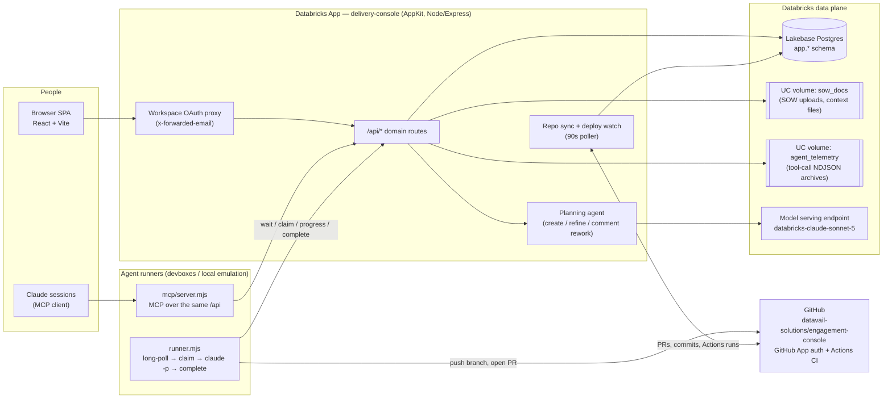
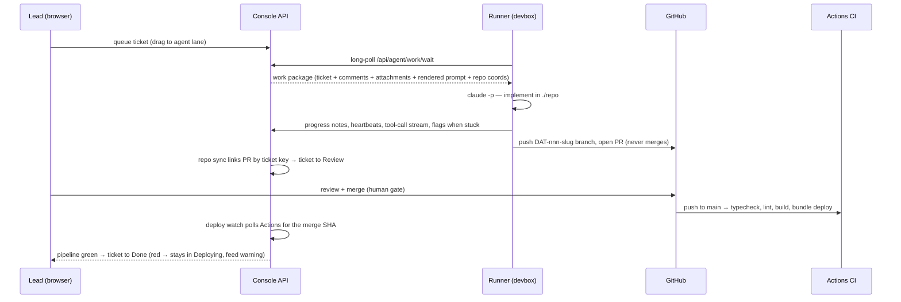

# Execution Console — System Architecture

How the delivery console is put together: one Databricks App serving humans
and agent runners, a Postgres work queue between them, and delivery
automation that closes the loop from ticket → branch → PR → deploy → Done.
Companion documents: [development-standards.md](./development-standards.md)
(working agreements), [agent-coordination.md](./agent-coordination.md)
(inter-agent protocol), [devbox-integration.md](./devbox-integration.md)
(runner setup).

## System overview

## Runtime components

**The app** is a single Databricks App process (`server/server.ts`) built on
AppKit with four plugins: `server()` (Express behind the workspace OAuth
proxy), `lakebase()` (Postgres), `files()` (two UC volumes), and `serving()`
(the model endpoint). It serves both the static client bundle and every
`/api/*` route. Identity arrives as `x-forwarded-email` headers from the
proxy and resolves to one of three roles — admin, lead, developer — with
lead-gated actions funneled through a single `requireLead` helper.

**The client** is a React SPA (Vite) with URL routing for every major
screen. Board cards animate through Motion layout springs; drag-and-drop is
a custom pointer engine (floating clone, slot-gap insertion preview,
persisted ordering). All markdown renders through one sanitized `Markdown`
component. Mutations are optimistic with rollback; the board polls every 8s.

**Data** lives in three places:

| Store | Contents |
|---|---|
| Lakebase Postgres (`app.*`) | engagements, tickets (+events/links/tags/attachments/estimates), comments, feed, team, agent_tasks, coordination_messages, repo connections/PRs/commits, PR review-SLA escalations, in-flight planning reviews |
| UC volume `sow_docs` | uploaded SOW/SOP documents, per-engagement context files, standards docs |
| UC volume `agent_telemetry` | per-run tool-call logs archived as NDJSON under `tool-calls/<engagement>/<ticket>/` |

Schema migrations run at boot from `*_SCHEMA_SQL` arrays (statements execute
independently; failures log without aborting). Tables owned by the developer
role can't take boot `ALTER`s from the app's service principal — those
migrations live in the idempotent `scripts/dev-migrate.cjs`, run manually
with a Lakebase credential.

## Server domain modules

`server/routes/` is one module per domain, wired in `api.ts`:

- `api.ts` — engagements, tickets CRUD, planning-agent flows, admin
- `agent-work.ts` — runner queue: wait/claim/heartbeat/flag/complete, work packages, rendered prompts
- `fleet.ts` — runner liveness: poll stamps, online/offline, the FLEET DOWN board warning
- `agents.ts` — the agent map: registered endpoint agents, configured runners, observed runners from task history
- `agent-security.ts` — per-agent security settings: model, validation, the lead-only settings API, and the enforcement check the execution paths call
- `coordination.ts` — inter-agent messages (announce, request/response, SLAs), mirrored to tickets
- `repos.ts` — GitHub/ADO providers: PR & commit sync, ticket auto-linking, merge-from-drawer, deploy watch
- `pr-conflicts.ts` — conflict reports, auto-resolve vs escalate assessment
- `pr-review.ts` — the PR review gate: case assembly, reviewer prompt, verdict parsing, PR + ticket publication
- `pr-requeue.ts` — merge-conflict requeue: classify the review outcome, put the ticket back at the top of the runner queue, cap the retries
- `pr-escalation.ts` — review-SLA watch: 24h lead ping, 48h PR comment + board flag, lead dismissal resets the timers
- `ticket-review.ts` — reason-based rejection out of Review: rejection history, requeue, prompt context
- `estimates.ts` — agent + human hour estimates, per-engagement calibration from actuals
- `planning-review.ts` — "agent reviewing" status while a planning pass rewrites a ticket: `app.planning_reviews` rows with a TTL, so a pass that dies mid-flight clears its own badge
- `ticket-events / -links / -tags / -order / -attachments` — the event trail, dependencies, tags, board ordering, file attachments
- `tool-calls.ts` — live tool-call streaming from runners, archived to telemetry
- `standards.ts` — per-engagement standards docs with AI-assisted editing
- `github-app.ts` — GitHub App JWTs, cached installation tokens, webhook HMAC
- `context-files.ts`, `extract-text.ts`, `roles.ts`, `seed-data.ts` — support

Every LLM call goes through `serving('default')` — no other model paths, no
keys in code. Prompts live server-side and version with the app; every
LLM-backed flow has a deterministic fallback so a model failure degrades a
feature, never a user action.

## The agent platform

The queue is plain Postgres (`app.agent_tasks`): runners long-poll a wait
endpoint, claim atomically, and work through Claude Code. The claim payload
carries everything — including the server-rendered prompt, so prompt changes
ship with console deploys instead of fleet updates. Runners are expected to
be chatty (progress notes, sub-2-minute heartbeats, flags instead of silent
death); a stalled-heartbeat detector and yellow flag badges surface trouble
on the board without moving lanes.

Two different silences get caught. A runner wedged mid-task is STALLED on its
card (DAT-184). A runner that is simply *gone* is caught by the poll stamp
(`app.runner_polls`): the wait long-poll carries the runner's name, so an idle
runner proves liveness every ~70s without extra traffic, and one that stops
reaching the console flips from `idle` to `offline` on the agent map. Queued
work with zero online runners for its engagement raises a board-level FLEET
DOWN banner and an activity-feed entry (DAT-224) — the failure that had two
tickets waiting nine hours behind a fleet that had already exited.

The same watch reclaims what the dead runners were holding. A claimed/working
task silent past the orphan window is released back to `queued` (agent
cleared, ticket out of progress) so any live runner takes it; after
`MAX_RECLAIMS` releases it fails for a human instead of cycling. The zombie
runner is handled by the existing contract from the other side: once the task
is no longer its own, the runner's next heartbeat 404s and it abandons the
run.

Runners never hold long-lived credentials: workspace tokens are minted via
the CLI (≤10 min cache, 401 → refresh-and-retry-once), and git access uses
installation tokens vended by the console's GitHub App (~1h TTL).

Concurrent runners coordinate through `app.coordination_messages`:
announce-your-branch, targeted request/response with SLAs, checkpoint
polling, everything mirrored onto tickets for human visibility. The live
two-runner round trip is drill-verified (see
[coordination-drill-run2.md](./coordination-drill-run2.md)).

The same API is exposed to AI tooling as an MCP server (`mcp/server.mjs`) —
board reads, ticket writes, queue control, flags, coordination, and
credential vending — so Claude sessions and runners speak one protocol.

## Per-agent security controls

Every agent on the map carries a `security_settings` object on
`app.project_agents`: an enable switch plus the permission scope it may
execute. Leads edit it from the agent's panel on `/agents`
(`PUT /api/projects/:id/agents/:agentId/security`, lead/admin only — an agent
can never widen its own scope). Four scopes map one-to-one onto real execution
points, and the check runs there, not at configuration time:

| Scope | Enforced at |
| --- | --- |
| `claim_work` | `POST /api/agent/work/claim` — a denied claim is released back to `queued` |
| `git_credential` | `POST /api/agent/work/:id/git-credential` — checked before any token is minted |
| `coordination` | `POST /api/agent/coordination/messages` and `/branches` |
| `pr_review` | `runPrReview()` — a blocked reviewer is skipped before its endpoint is invoked |

Denials return 403 with the reason and land on the engagement feed, so a
blocked action is visible to humans and not just to the agent that hit it.

Two invariants shape the design. **No silent lockouts**: an agent with no
stored settings falls back to the baseline for its role, and the rollout
migration backfilled every existing agent with exactly the scopes it already
exercised (delivery runners `standard`, review agents `coordination` +
`pr_review`) — nothing removed, nothing new granted. **No wedged tickets**:
winding down a task the agent already holds — progress notes, flags,
completion — is deliberately not gateable, so disabling or narrowing an agent
never strands a run mid-flight. Stopping a live run is a board cancel.

## Delivery automation

Ticket keys are the join key for everything: a `DAT-nnn` in a branch name or
PR title auto-links commits and PRs to the ticket. Automation then drives
the board: PR opened → Review; PR merged → Deploying, the lane between
sign-off and Done where the ticket waits while Actions runs for the merge SHA
→ Done on green, stays in Deploying with a warning on red. A reviewer can put
a ticket in Deploying by hand too: the drawer's Review bar approves in one
click (or rejects with a required note, which sends the ticket back to Backlog
and saves the note to its history) and then loads the next ticket in Review,
so a queue of sign-offs is worked without returning to the board.
Merging is possible from the ticket drawer itself
(lead-only, click-to-confirm). Conflict tooling gives agents a safe path:
report conflicts, auto-resolve only trivial ones, escalate anything that
overlaps another ticket's open PR.

A merge conflict is the one review outcome that jumps the queue. When the
review gate publishes a verdict, `pr-requeue.ts` asks the provider whether the
PR still merges; if it does not — or the reviewer names a conflict while
mergeability is not yet computed — the ticket goes back into
`app.agent_tasks` at a priority above anything the board can assign, carrying
instructions to resolve that conflict and nothing else. Claiming already
sorted `priority DESC, id`, so the conflict is the next pickup and several
conflicts stay FIFO among themselves. Every other review failure (tests,
lint, unmet criteria) keeps the human path. The loop is bounded: three
automatic attempts on the same PR, then the conflict is flagged for a
developer instead of requeued, and each decision is recorded in
`app.pr_requeues` with the PR number, reason and timestamp.

Reviews get a clock too: an open PR that no one has reviewed 24h after the
runner opened it pings the engagement lead in the notification centre, and at
48h the console posts a summary comment on the PR and flags the ticket on the
board. Every stage transition is claimed with a conditional UPDATE, so a
threshold checked repeatedly still notifies exactly once; a lead can dismiss
the escalation from the ticket drawer, which resets both timers, and review,
merge or closure stops the clock for good.

Review has a second exit next to approval: a lead can reject a ticket that is
in Review with a reason (`POST /api/tickets/:key/reject`, the drawer's REVIEW
panel). The reason is mandatory — a blank one is refused before anything is
written — and the ticket goes back to Backlog, never Done, re-queued for an
agent by default. Reasons accumulate in `app.ticket_rejections` (one row per
cycle, so a third rejection does not erase the first two) and the newest five
are rendered into the runner prompt above the lead instructions, so the next
run starts from the reviewer's words instead of a cold re-read.

CI (`deploy.yml`) runs typecheck → lint → build → `databricks bundle
deploy` → `bundle run app` on every push to main, serialized by a
concurrency group (queued intermediates supersede, so merge bursts batch
into few deploys). Each deploy restarts the app — expect ~1 minute of 502s.

## Key decisions

- **GitHub over ADO** for this repo (tenant conditional-access blocked ADO);
  multi-provider architecture for ADO-hosted client code is an open design
  ticket (DAT-147).
- **One process, no queues/infra beyond Postgres** — the work queue,
  coordination channel, and event trail are all Lakebase tables.
- **Humans merge** — agents and Claude sessions stop at the PR.
- **Prompts are server code** — versioned, deployed, and rendered into work
  packages centrally.
- **Shared checkout discipline** — parallel Claude sessions use worktrees;
  the local emulation runner is pinned to `main` in its own worktree.
