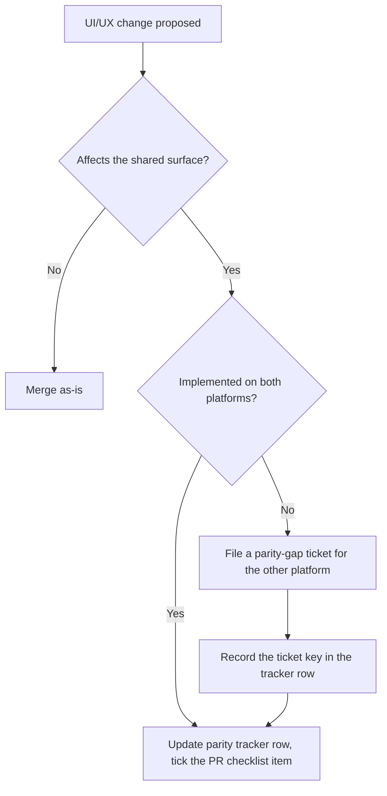

# Cross-platform parity process (DAT-258)

The web console (`client/`) and the desktop app (`desktop/`) are developed
somewhat independently, and nothing technical forces a UI/UX improvement made
on one to appear on the other. This document is the lightweight process that
catches that drift: how a change is classified, when the
[feature parity tracker](./feature-parity-tracker.md) gets updated, how gaps
become tickets, and who re-audits.

It is process, not tooling — the enforcement points are the PR checklist and
the review gate, both of which already exist.

## The shared surface, concretely

Parity is only a question for UI/UX that both platforms implement separately.
In this codebase that surface is small and known:

- **`shared/design/`** — the token sheet (dark + light), `eec-*` keyframes,
  `hv-*` microinteractions. The desktop imports it; the web still carries its
  own copy (tracked as a gap).
- **Desktop-native views** (`desktop/src/renderer/`) — Agents, Identity,
  Deploys, Terminal, title bar. These re-implement console idioms by hand:
  `mono()` typography, card/row visual language, state colors, scrollbars.
- **Client idioms that native views mirror** — markdown rendering, toasts,
  theme toggle, fonts.

Everything else is exempt by construction: the desktop Tickets tab embeds the
deployed web app in a webview, so board/drawer/planning changes reach desktop
automatically, and features like Agents or Identity are deliberately
platform-exclusive.

## Parity classes

Every UI/UX change lands in exactly one class:

| Class | Meaning | What you owe |
| --- | --- | --- |
| **By construction** | One implementation serves both (webview-embedded console, imports of `shared/design/`) | Nothing |
| **Shared by design** | Implemented separately on each platform, expected to match | Tracker row + parity confirmed or a gap ticket |
| **Platform-exclusive** | Deliberately one platform | Nothing — but say so in the PR if it's a new surface, so the tracker records the classification |

When in doubt, ask: *would a user notice the platforms disagree?* If yes, it
is shared by design.

## The flow

In practice:

1. **Author**: your PR touches `shared/design/`, `desktop/src/renderer/`, or a
   client idiom that native views mirror (tokens, markdown, toasts, theme,
   fonts). The PR template's parity item applies — tick the branch that's
   true, update the tracker's row (status + last-reviewed date) in the same
   PR, and file a gap ticket if the other platform now lags.
2. **Reviewer**: an unticked or dishonestly-ticked parity item is a review
   comment like any other. The tracker edit riding in the same diff is what
   makes this checkable at a glance.
3. **Gap lives as a ticket**, not a TODO: the tracker row points at the
   ticket, the ticket closes when the lagging platform catches up, and the
   closing PR flips the row back to ✅.

## Gap tickets

- Title: `Parity: <feature> on <platform>` (e.g. `Parity: light theme on
  desktop`), tagged **`parity-gap`**.
- Body links the tracker row and names the reference implementation (file
  paths on the platform that already has the feature).
- A gap ticket is a normal backlog item — priority is the lead's call. The
  point is that the gap is *visible on the board*, not that it jumps the
  queue.

## Ownership & cadence

- **The eng lead owns the process**: they arbitrate classification disputes,
  own the re-audit, and are the default assignee for unowned gap tickets.
  (Initial setup assumed this default — confirm or reassign at the next
  delivery sync; update this line when decided.)
- **Re-audit monthly, or before any desktop release tag**, whichever comes
  first. A re-audit is: walk the tracker's shared-by-design rows, spot-check
  each against both platforms, refresh the last-reviewed dates, and file
  tickets for anything that drifted in unnoticed. The initial audit
  (2026-08-26) took under an hour; the surface is small.
- **The tracker is the record.** If a row's last-reviewed date is stale by
  more than a re-audit cycle, treat its status as unknown.

## Standing exemptions

Recorded here so they are decisions, not omissions:

- The desktop webview shows the **deployed** web bundle — parity by
  construction is parity with production, not with `main`.
- The Deploys surface is **intentionally asymmetric** (desktop executes, web
  mirrors read-only). Track that the mirror keeps up with executor state
  changes, not that the surfaces look identical.
- Native-exclusive surfaces (Agents, Terminal, Identity, local sync) never
  appear on the web by design.
