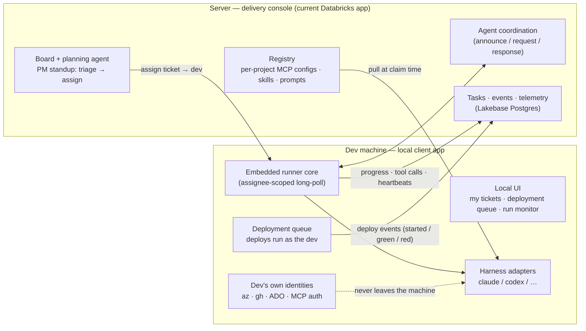

# Delivery Tool — Server/Client Architecture Plan

Working plan for the local delivery tool (Nigel's notes, 2026-08-24, plus
follow-up direction). **Core principle: runners sit locally on each dev's
computer**, wrapped in a local UI app, using the dev's own auth identities —
no shared VM runners to manage. The current Databricks app stays as the
server: PM plane, coordination, and the source of truth for shared config.
Companion documents: [architecture.md](./architecture.md) (current system),
[local-client-architecture.md](./local-client-architecture.md) (the
detailed client build plan), [development-standards.md](./development-standards.md).

## The split

| | Server — current Databricks app | Client — local app (per dev machine) |
|---|---|---|
| Owns | Tickets, board, planning agent, PM workflows (standup triage & assignment) | The runner itself: claim → implement → PR |
| Manages | Per-project MCP configs, skills, prompts — versioned, distributed | Harnesses (Claude Code, Codex, …), repos/worktrees |
| Coordination | Inter-agent messages, SLAs, conflict escalation (stays server-level) | Participates via the existing API |
| Identity | Workspace OAuth for humans; short-lived vending only | Dev's own az / gh / ADO logins; MCP auth; nothing shared |
| Deploy | **Deploy column removed from the board** | Deployment queue lives here; deploys run as the dev |
| State | Postgres: tasks, events, telemetry, coordination | Local state file (SQLite/DuckDB): run history, queue, config |

The trust boundary is unchanged and is the whole point: the server never
holds a dev credential, a checkout, or a harness process. What changes is
**who a task is for** — work routes to a person's machine, not to an
anonymous fleet.

## Target architecture



## Why this model works (assessment)

- **It solves the credential problem structurally.** Devs deploy and push
  as themselves; the ADO conditional-access blocker (DAT-147) largely
  disappears because a dev's own AAD identity is exactly what tenant
  policy permits. Nothing to rotate, no shared VM fleet to patch.
- **The protocol change is small.** Heartbeats, progress notes, tool-call
  streaming, flags, and coordination all already flow client→server over
  plain HTTPS long-poll — outbound-only, so laptops behind home firewalls
  work unchanged. The one real change: `app.agent_tasks` gains an
  assignee, and `wait/claim` becomes identity-scoped (a client only sees
  work assigned to its dev).
- **Capacity scales with the team for free** — every hire brings a runner.
- **Central control is preserved** where it matters: prompts already ship
  server-rendered in the work package; MCP configs, skills, and prompts
  extend the same pattern via the registry. A dev machine executes; it
  doesn't define the work.

## The standup model

PM-side, on the existing board: walk the backlog in a triage view, refine
with the planning agent, and **assign tickets to devs** (replacing "drag
to the agent lane" as the primary flow — the anonymous-fleet lane can
remain for internal/unattended work). Assignment writes an
assignee-scoped task; the dev's local client picks it up when they're
online and lets them order their own queue.

Board lifecycle without a Deploy column: `… → In Progress (claimed on the
dev's machine) → Review (PR opened) → Done`. Merge still happens on the
server side of the flow (humans merge, unchanged).

## Deploys move local — but report home

The dev's client owns a **deployment queue**: merged tickets targeting
environments the dev deploys to (client infra, ADO-hosted repos, anything
requiring their identity). Deploys execute locally as the dev.

Recommendation: keep the server informed with **deploy events** (started /
succeeded / failed, ticket-keyed) posted by the client — the same pattern
as today's deploy watch, with the client as the source instead of GitHub
Actions polling. The PM keeps the visibility the Deploy column used to
give (ticket auto-advances to Done on green, feed warning on red) without
the column existing. For this repo's own CI-driven deploys, the existing
Actions deploy watch stays as-is.

## The local client app

A desktop GUI (not a TUI). **Electron** recommended: the runner core and
`devbox-runner/harnesses.mjs` adapters are Node, harnesses are Node CLIs
spawned as child processes, and the team stack is TypeScript/React —
main process hosts the runner, renderer reuses the client's component
idioms. Tauri is the fallback if footprint becomes a complaint.

Surfaces:

- **My tickets** — the dev's assigned queue: reorder, start/pause the
  runner, watch live tool calls (the same stream the server archives).
- **Deployment queue** — merged work awaiting a local deploy; one-click
  deploy with live log; posts deploy events home.
- **Harnesses** — detect/select adapters per ticket or per project;
  adapter config; registry-pulled MCP configs wired in exactly as
  `writeConfig()` does today.
- **Identity** — az/gh/ADO login state, device-code flows from the UI,
  tokens in the OS keychain; per-MCP-server auth.
- **Presence** — the client heartbeats while open so the PM board shows
  who's online and what their queue depth is; offline devs' assignments
  visibly sit, and reassignment is one drag.

Design direction stays Omarchy-inspired (see earlier iteration): tiled
panes, accent-bordered focus, command palette, status bar, JetBrains Mono,
token-based theme system shared with the deliverable/design-system skill.

Project structure (monorepo, adapters shared):

```
desktop/            # Electron app (main = runner host, renderer = React UI)
shared/harnesses/   # adapters move here; consumed by desktop/ and devbox-runner/
devbox-runner/      # kept for unattended/internal fleet work, same core
```

## Server additions

1. **Assignee-scoped queue** — assignee on `app.agent_tasks`; `wait/claim`
   filtered by identity; standup triage/assign UI on the board; Deploy
   column removed.
2. **Registry** — per-project MCP configs, skills, and prompts versioned
   server-side (`/api/registry/*`), pulled by clients at claim time. Same
   philosophy as "prompts are server code", extended to the rest of the
   work-defining config.
3. **Deploy events** — client-reported deploy status keyed by ticket;
   drives Done-on-green and feed warnings in place of the column.
4. **Email → task assignment** (from the notes, later phase) — inbound
   mail → planning agent draft → Intake for confirmation.

## Build order

| Phase | Deliverable | Proves |
|---|---|---|
| 1 | Assignee-scoped queue + standup assign UI; Deploy column removed behind a flag | New routing model, PM flow |
| 2 | Electron shell: attach as a dev, "my tickets", embedded runner (claim → PR) with live tool-call pane; adapters to `shared/harnesses/` | Local-runner principle end to end |
| 3 | Identity broker (keychain, device-code flows) + MCP auth UI | Own-identity model |
| 4 | Deployment queue + deploy events; board Done-on-green from client reports | Deploy moves local without losing PM visibility |
| 5 | Registry (MCP configs / skills / prompts) pulled at claim time | Central definition, local execution |
| 6 | Email intake; theme/design-system + deliverable (PPTX) skill | Notes backlog |

## Open questions

- Does the anonymous fleet lane (current devbox runners) stay for internal
  work, or does everything become assigned-to-a-person? (Plan assumes both
  coexist on one queue with and without assignees.)
- Offline policy: how long may an assigned ticket sit on an offline dev
  before the board flags it for reassignment?
- Deploy events trust: client-signed like coordination identity, or is
  console auth per dev sufficient?
- Registry publishing: lead-gated like merges, or open to dev pushes?
