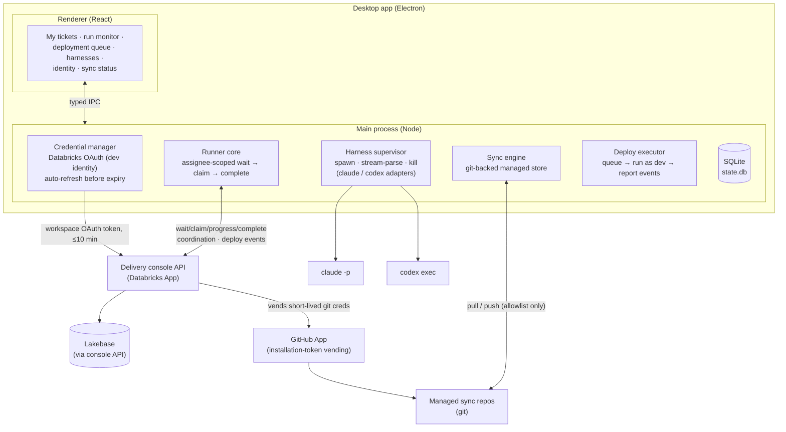

# Local Client — Build Plan

The concrete architecture for the local delivery tool described in
[delivery-tool-plan.md](./delivery-tool-plan.md): a desktop app that runs
on each dev's machine, wraps Claude Code and Codex, keeps runner/harness
config and auth local, matches the web console's look and feel, and syncs
managed files through a central git-backed store. The off-platform access
pattern follows the Databricks *lakebase-off-platform* template
(env-driven config, auto-refreshing credential manager, dual dev/prod
auth modes).

## Status (as of 2026-09-11)

This is the plan the desktop client was built from; the sections below are
kept as the design record. What actually shipped, against the build order:

| Step | Status | Shipped as |
|---|---|---|
| 1 — `shared/` extraction | ✅ | DAT-226: `shared/design/tokens.css`, `shared/harnesses/`, `shared/api-client/` (the web `client/` still carries its own token copy — tracked in [feature-parity-tracker.md](./feature-parity-tracker.md)) |
| 2 — Electron shell, OAuth, My Tickets | ✅ | DAT-226 scaffold, DAT-228 native browser OAuth (PKCE, `safeStorage`), DAT-227/229 assignee-scoped queue + board assignment, DAT-232 Tickets tab = embedded deployed console |
| 3 — Runner + supervisor | ✅ | DAT-230 embedded runner, DAT-245 multi-instance agents page + auto-start, DAT-240 terminal pane (node-pty + xterm), DAT-234 orphan recovery, DAT-248/264 delivery-scoped permission allowlist, DAT-266 token metrics |
| 4 — Identity broker | ✅ | DAT-235: GitHub / Azure / ADO device-code sign-ins, MCP secrets, dev-credential runs |
| 5 — Sync engine + managed sync repos | ⏳ not started | The **Sync** nav entry is a placeholder; no server-side registry routes yet |
| 6 — Deployment queue + release pipeline | ✅ | DAT-236 local deploy queue + deploy events (web mirror read-only), DAT-237 tag-driven releases + silent auto-update (code signing still procurement-gated) |

Deviations from the plan worth knowing before you read on:

- **Local state is `config.json`** under the Electron `userData` dir (zod
  schema in `desktop/src/main/config.ts`), not SQLite; run history lives in
  memory per instance and on the console. `better-sqlite3` and `keytar` are
  not dependencies — secrets go through Electron `safeStorage` only.
- **React 19**, matching the web console, not React 18.
- **Look and feel** — the desktop imports `shared/design/tokens.css`; the web
  console does not yet, so token edits are made twice until the parity gap
  ticket lands. The desktop is dark-only today (theme toggle is a tracked gap).
- **Harness adapters** live in `shared/harnesses/` and are consumed by both
  the devbox runner and the desktop supervisor, as planned.

## Goals and non-goals

**Goals**

- Runs entirely locally; distributes as a simple installer with
  auto-update. No shared VM fleet, no server-side runner management.
- Visual parity with the web console — same tokens, fonts, and component
  idioms, so it reads as the same product.
- Wraps Claude Code and Codex through the existing harness adapters; new
  harnesses stay one-adapter additions.
- All identity local: Databricks OAuth as the dev, gh/az/ADO logins, MCP
  server auth — nothing shared, nothing long-lived at rest.
- Central managed file store (git-backed) for project files, context,
  prompts, skills — synced deliberately via manifest, never "whatever is
  on disk."

**Non-goals (v1)**

- Replacing the web console for PM flows (board, planning, standup stay
  in the browser).
- Multi-tenant packaging; this is an internal tool.
- Replacing the devbox fleet — headless runners keep working unchanged.

## Stack

| Concern | Choice | Why |
|---|---|---|
| Shell | **Electron** (main = Node host, renderer = React + Vite + TS) | Runner core and adapters are Node; harnesses are Node CLIs; team stack is React/TS. Direct reuse beats Tauri's smaller footprint (which would need a Node sidecar anyway). |
| UI | React 18 + the console's design tokens; `@databricks/appkit-ui` where it fits | Look-and-feel parity by construction |
| Local state | SQLite (`better-sqlite3`) at `%APPDATA%/delivery-console/state.db` | Run history, queue cache, settings; local-first, offline-safe |
| Secrets | OS keychain via Electron `safeStorage` (+ `keytar` fallback) | Tokens never in files or SQLite |
| Config | Zod-validated, env/file-driven (lakebase-off-platform pattern) | One schema, fails loud at startup, portable |
| Packaging | `electron-builder`, cross-platform: Windows first (NSIS installer + portable exe), macOS (dmg) and Linux (AppImage) from the same config; auto-update from GitHub Releases | Windows is the primary target; Electron makes the other two nearly free |
| Sync backend | Git (dedicated repos vended by the console's GitHub App) | See "Managed file sync" |

## Process architecture



Renderer never touches the network or secrets directly — everything goes
through a typed IPC contract to the main process (contextIsolation on,
nodeIntegration off). That keeps the security review surface in one
place.

## Auth: the off-platform pattern, applied

Copy the lakebase-off-platform template's shape, swapping "Postgres
password callback" for "API bearer token":

1. **Config layer** — a single Zod schema validates everything the app
   needs at startup (console URL, Databricks host, profile name, sync
   remote). Values come from env / a config file the app writes; no
   scattered reads.
2. **Credential manager** — one module owns Databricks auth, and the app
   runs OAuth itself (DAT-228): first sign-in opens the system browser on
   the workspace's `/oidc/v1/authorize` (authorization code + PKCE against
   the registered `databricks-cli` public client, loopback redirect), the
   refresh token lands encrypted via `safeStorage` (DPAPI/Keychain/
   libsecret), and renewal is silent from then on — no Databricks CLI
   required. The manager hands out workspace access tokens with
   auto-refresh *before* expiry, and every API client gets its token via
   callback — the same pattern the template uses for pool passwords. The
   devbox runner's "≤10 min cache, 401 → refresh-and-retry-once" behavior
   is subsumed by this.
3. **Fallback modes** — `DATABRICKS_TOKEN` env for dev hacking (never
   persisted), and a silent Databricks CLI fallback for machines that
   already have a live CLI session. Mirrors the template's dev/prod split.
4. **Other identities** — gh/az/ADO device-code flows launched from the
   Identity screen; state readable, tokens in the keychain. Git pushes to
   *work repos* keep using console-vended GitHub App installation tokens;
   git operations against *client-owned repos* (ADO) use the dev's own
   identity — which is the point of the whole model.
5. **Lakebase** — v1 does **not** connect the client to Postgres
   directly; all data access rides the console API where role gating
   lives. The template's direct-connection pattern is the documented
   escape hatch if a future feature (e.g. local telemetry analytics)
   needs read-only DB access — same credential manager, add the password
   callback.

## Harness wrapping

`devbox-runner/harnesses.mjs` moves to `shared/harnesses/` and is
consumed unchanged by both the devbox runner and the desktop app. The
main-process supervisor adds what a headless runner never needed:

- Lifecycle: spawn per claim in the ticket worktree, stream-parse stdout
  through the adapter (`parseLine` → tool-call feed), heartbeat, kill/
  restart from the UI.
- **No terminal windows, ever.** Harnesses run as child processes with
  piped stdio (`windowsHide: true` on Windows) — headless by design, with
  their output rendered in the app's run monitor pane. When a dev wants a
  real interactive session, the app embeds one: `node-pty` + xterm.js in
  a pane (the VS Code integrated-terminal pattern), attached to the same
  working directory — never a floating console window.
- Per-project harness config: which harness, model/args, permission mode
  — stored locally, overridable per ticket at claim time.
- MCP wiring exactly as `writeConfig()` does today, with configs pulled
  from the console registry (server-defined, locally applied).
- Both adapters exist and are proven (Claude Code stream-json; Codex
  fixed against its real event stream in b5a7c70) — the desktop app adds
  zero new harness-specific code.

## Managed file sync (git backend)

**Recommendation: yes, git — with an allowlist manifest, not a
blocklist.** The failure mode to design against is "local junk leaks
up"; you prevent that by only ever syncing paths the manifest names.

- Each engagement gets a **managed sync repo** (e.g.
  `engagement-console-sync-<engagement>`), created and permissioned by
  the console through the existing GitHub App. It is app-managed: devs
  never open it by hand; the desktop app is its only writer.
- A `sync.manifest.json` at the repo root (authored server-side, edited
  in the console) declares what syncs and where it lands locally:

  ```json
  {
    "sync": [
      { "path": "context/",   "local": "{workspace}/context/",  "mode": "two-way" },
      { "path": "prompts/",   "local": "{workspace}/prompts/",  "mode": "pull-only" },
      { "path": "skills/",    "local": "{workspace}/skills/",   "mode": "pull-only" },
      { "path": "standards/", "local": "{workspace}/standards/", "mode": "pull-only" }
    ]
  }
  ```

  Anything not listed never leaves the machine — repos being worked on,
  node_modules, credentials, scratch files are structurally excluded
  rather than filtered.
- The sync engine is plain git under the hood (shallow clone, sparse
  checkout of manifest paths, commit-and-push on change with the app as
  author, pull on interval/reconnect). Git gives history, diffs, offline
  tolerance, and conflict handling for free; conflicts surface in the UI
  as "theirs/mine" with the server copy winning by default for pull-only
  paths.
- Server side, the console keeps treating UC volume `sow_docs` as the
  human upload surface; a small bridge job commits volume changes into
  the sync repo (or the console writes both). Registry content (MCP
  configs, skills, prompts) distributes through the same repo — one
  channel, versioned, auditable.

## Look and feel parity

- Extract the console's theme into `shared/design/`: the token sheet
  (`--bg/--tx/--acc/--agent/...` dark+light), `eec-*` keyframes, `hv-*`
  microinteractions, the `mono()` helper, and DM Sans/DM Mono loading.
  `client/` and `desktop/renderer/` both import it — parity stops being
  a discipline and becomes a build fact.
- Reuse portable components where they don't drag app state with them:
  `Markdown`, chips/badges, the ticket-card visual language, drawer
  layout. Board-specific drag/drop stays web-only.
- Desktop chrome: frameless window with a custom title bar styled like
  the console header, so the app doesn't look like a browser wrapped in
  Windows chrome.

## Repo layout and distribution

```
desktop/
  main/            # credential manager, runner core host, harness supervisor,
                   # sync engine, deploy executor, IPC handlers
  renderer/        # React UI (Vite), imports shared/design
  electron-builder.yml
shared/
  design/          # tokens, keyframes, fonts, mono()
  harnesses/       # adapters (moved from devbox-runner)
  api-client/      # typed console API client + credential-callback auth
devbox-runner/     # unchanged behavior; imports shared/harnesses
```

Distribution: a `desktop-release.yml` workflow matrix-builds on tag push
— Windows NSIS installer + portable exe (primary), macOS dmg, Linux
AppImage — publishes to GitHub Releases, and `electron-updater` checks
that feed. Devs install once; updates are silent. Cross-platform notes:
`safeStorage` maps to DPAPI / Keychain / libsecret per OS, so the secrets
story ports unchanged; `better-sqlite3` prebuilds per platform via
electron-builder; harness paths and worktree handling must stay
path-separator-agnostic from day one (Windows dev machines are where that
usually breaks — here it's the primary target, so it gets tested first).
Windows code-signing cert (and Apple notarization if macOS uptake is
real) are the procurement items to start early; MSIX/winget later if IT
wants managed rollout.

## Build order

| Step | Deliverable | Notes |
|---|---|---|
| 1 | `shared/` extraction: design tokens, harness adapters, typed API client with the credential-manager auth | Pure refactor; web app and devbox runner keep working |
| 2 | Electron shell: OAuth first-run, config schema, custom chrome, read-only "my tickets" against the (new) assignee-scoped queue | First installable build |
| 3 | Runner + supervisor: claim → worktree → harness (claude/codex picker) → PR, live tool-call pane, heartbeats | The wrapper thesis, end to end |
| 4 | Identity screen + keychain storage; gh/az/ADO device flows; MCP auth | |
| 5 | Sync engine + managed sync repos + manifest editing in the console | |
| 6 | Deployment queue + deploy events home; release pipeline + auto-update | Board's Deploy column retires when this lands |

Server-side prerequisites (can start immediately, independent of the
desktop work): assignee on `app.agent_tasks` + identity-scoped
wait/claim; registry routes; sync-repo provisioning via the GitHub App;
deploy-events endpoint.

## Open questions

- Sync repo hosting for client-owned engagements: our GitHub org (data
  residency implications?) or the client's ADO project using the dev's
  identity?
- Manifest authority: lead-gated edits only, or can devs add two-way
  paths?
- Codex auth: dev's ChatGPT/OpenAI login is local like everything else —
  confirm license/seat model before rollout.
- Code-signing certificate owner and timeline (blocks silent
  auto-update).
