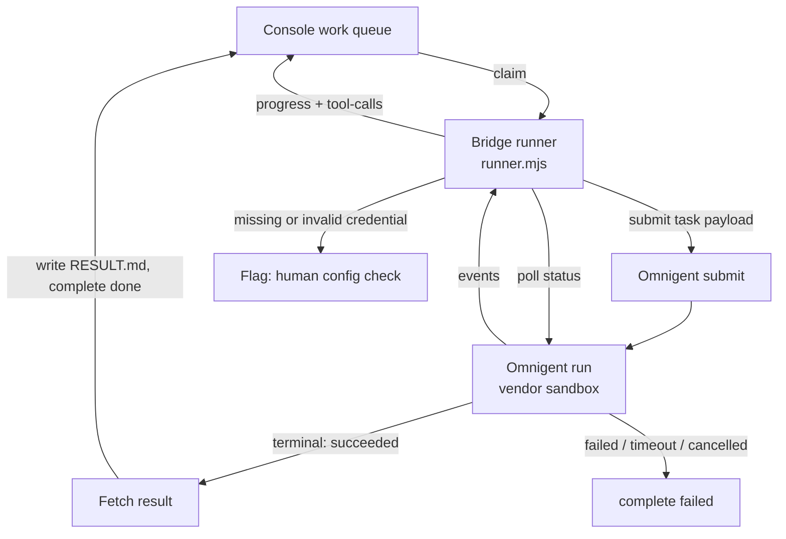

# Omnigent as a delivery runner — architecture

**Ticket:** DAT-221 · **Status:** design, partially blocked on vendor docs (see
[Gaps and blockers](#gaps-and-blockers)) · **Scaffolding:** landed, non-functional by
design.

This document specifies how Omnigent is added as a runner option alongside Claude
Code and Codex, so a lead can drop a ticket into **◆ Deploy to Agent** and have it
executed by Omnigent with no change to the board, the queue, or the ticket
lifecycle.

> **Read this first.** Every statement about *our* side of the contract is verified
> against the code and is safe to build on. Every statement about *Omnigent's* side
> is a **requirement we place on it**, not an observed fact — the vendor API was not
> available during this design (see [Gaps](#gaps-and-blockers)). Those are tagged
> **⚠ CONFIRM** and are deliberately isolated behind configuration so confirming them
> is a config change, not a redesign.

---

## 1. The existing runner contract

Two seams already exist, and they are not the same thing. Getting them
straight is the whole design.

### 1.1 The console contract (HTTP) — stable, Omnigent-agnostic

The console owns a work queue and knows nothing about how work gets done. A runner
is *any process that can reach the app URL with a Databricks OAuth token*
([devbox-integration.md](./devbox-integration.md)). The lifecycle is:

```
queued → claimed → working → done | failed        (or cancelled by a lead)
```

| Step | Endpoint |
|---|---|
| Wait for work | `GET /api/agent/work/wait` (long poll) |
| Claim atomically | `POST /api/agent/work/claim` → work package + server-rendered prompt |
| Vend git credential | `POST /api/agent/work/:id/git-credential` (~1h GitHub App token) |
| Progress note / heartbeat | `POST /api/agent/work/:id/progress` |
| Live tool feed | `POST /api/agent/work/:id/tool-calls` (batched, ≤200/batch) |
| Raise / clear a flag | `POST` / `DELETE /api/agent/work/:id/flag` |
| Finish | `POST /api/agent/work/:id/complete` (`done` \| `failed`) |

**Nothing in this layer changes for Omnigent.** That is the point of the design: an
Omnigent-backed runner is a client of exactly these endpoints, so the board, the
STALLED detector, PR auto-linking, comment steering and telemetry archival all keep
working untouched.

### 1.2 The harness contract (in-process) — subprocess-shaped

`devbox-runner/harnesses.mjs` is where the fleet's agent-specific code lives. An
adapter is:

```js
{ name, bin, args, promptVia, parseLine(line, emit), writeConfig(dir, mcpServerPath) }
```

`runner.mjs` owns the invariant lifecycle — wait → claim → materialize workdir →
heartbeat → run agent → read `RESULT.md` → complete — and touches none of the above.

**This seam assumes the agent is a local child process**, and it assumes it in four
separate places:

1. `runAgent()` calls `spawn(HARNESS.bin, args)` — there must be an executable.
2. Output arrives as **lines on stdout**, which is why the hook is `parseLine`.
3. Completion is a **process exit code**.
4. The result is `RESULT.md` **on the local filesystem**, written by the agent into
   the workdir the runner created.

Omnigent, as a hosted service, satisfies none of the four. This is the central
finding of DAT-221 and it drives everything below.

---

## 2. Two possible shapes, and which one we design for

| | **Shape A — local CLI** | **Shape B — hosted service** |
|---|---|---|
| What Omnigent is | an executable on the runner box | an API you submit tasks to |
| Work needed | one entry in `harnesses.mjs` | a new adapter *mode* + a poll loop |
| Where the repo lives | the runner's workdir | Omnigent's sandbox |
| Who pushes the branch | Omnigent, via local `GIT_TOKEN` | Omnigent, via a credential we hand it |

**If Omnigent ships a prompt-taking CLI, stop reading — use `HARNESS=generic` today:**

```bash
HARNESS=generic AGENT_BIN=omnigent AGENT_ARGS='run --non-interactive' \
  AGENT_LABEL=omnigent node devbox-runner/runner.mjs
```

That already works, with no code change, at the cost of a raw (unparsed) activity
feed. A dedicated Shape-A adapter would only add stream parsing and MCP wiring.

**This design targets Shape B**, because "integrate Omnigent's API/SDK" is what the
ticket asks for and because Shape B strictly contains Shape A's requirements. ⚠ CONFIRM
which shape Omnigent actually is — it changes the effort estimate by roughly an
order of magnitude.

---

## 3. Target architecture

The runner box becomes a **bridge**: it still owns the console-side lifecycle, but
delegates execution to Omnigent and translates between the two.



### 3.1 The adapter contract, generalized

The existing adapter shape is kept verbatim for `claude`/`codex`/`generic`. One
discriminator field is added, defaulting to today's behaviour so nothing existing
moves:

```js
mode: 'process' | 'service'    // absent ⇒ 'process'
```

A **service** adapter replaces `bin`/`args`/`promptVia`/`parseLine` with four
methods. `writeConfig` is retained (a no-op for Omnigent — MCP is wired by the
bridge, not the workdir):

| Method | Contract |
|---|---|
| `submit({ pkg, prompt, workdir, git }, ctx)` | Hand the task to Omnigent. Returns an opaque `handle` (run id + whatever else polling needs). |
| `poll(handle, ctx)` | One status check. Returns `{ state, events[] }` where `state ∈ running \| succeeded \| failed \| cancelled` and `events[]` are normalized activity records. |
| `fetchResult(handle, ctx)` | Terminal only. Returns `{ summary, prUrl? }` — the text that becomes `RESULT.md`. |
| `cancel(handle, ctx)` | Best-effort abort, for the watchdog and console-side cancellation. |

`runner.mjs` gains exactly one branch — `mode === 'service'` drives a poll loop
instead of `spawn` — and every other stage of the lifecycle is shared code. See
§7 for what actually landed.

### 3.2 Why events, not lines

`parseLine` exists to turn a stdout line into `emit.print(text)` / `emit.tool(name, input)`.
A service adapter emits into **the same `emit` sink** from `poll()`. That is what
keeps the live TOOL ACTIVITY feed, the terminal rendering and the telemetry archive
identical across harnesses — the bridge changes where events come from, not what
they are.

Because polls return *cumulative* history, the adapter must track a cursor
(sequence number or timestamp) inside the handle and emit only what is new.
Re-emitting on every poll would flood the feed and the archived NDJSON. ⚠ CONFIRM
whether Omnigent's status response is cursorable, or whether it returns the full log
each time and the bridge must dedupe (see [Gaps](#gaps-and-blockers)).

---

## 4. Task handoff format

### 4.1 Board → Omnigent (submit)

The console already renders the authoritative prompt server-side and ships it in the
work package (`pkg.prompt`) — *prompt wording is owned by the console repo, so
changing it is a console deploy, not a fleet update*
([development-standards.md](./development-standards.md)). The bridge must not
rewrite it. The submission is therefore mostly a passthrough:

```jsonc
{
  "prompt": "<pkg.prompt verbatim — the server-rendered instructions>",
  "metadata": {                      // for vendor-side tracing//search only
    "ticket": "DAT-221",
    "task_id": 157,
    "engagement": "execution-console",
    "runner": "omnigent-1"
  },
  "workspace": {
    "repo_url": "https://github.com/datavail-solutions/engagement-console",
    "default_branch": "main",
    "credential": "<short-lived GitHub App installation token>"
  },
  "attachments": [                   // context files + ticket attachments
    { "name": "…", "content_base64": "…" }
  ],
  "limits": { "max_run_seconds": 10800 }   // mirrors MAX_RUN_MINUTES (180)
}
```

Notes that matter:

- **The prompt is the contract.** It already tells the agent to branch as
  `DAT-221-<slug>`, push, open a PR, check the PR for merge conflicts, and write
  `RESULT.md`. Omnigent inherits all of that for free — *provided* it can run git
  and reach GitHub (⚠ CONFIRM).
- **Attachments are inlined** because Omnigent cannot read our local workdir and the
  console's download URLs require a Databricks OAuth token we must not hand out. If
  Omnigent supports a file-upload API, prefer that over base64 in the body — inlining
  will hit request-size limits on large context files. ⚠ CONFIRM.
- **`limits.max_run_seconds` is defence in depth.** The bridge's own `MAX_RUN_MINUTES`
  watchdog is authoritative; this is a hint so the vendor stops burning budget on a
  run we have already abandoned.

### 4.2 Omnigent → board (poll and result)

Two normalized shapes the adapter must produce, whatever the vendor's wire format:

```jsonc
// poll(handle) →
{
  "state": "running",                          // running|succeeded|failed|cancelled
  "events": [
    { "kind": "text", "text": "Reading the runner contract…" },
    { "kind": "tool", "name": "Read", "input": { "file_path": "devbox-runner/harnesses.mjs" } }
  ]
}

// fetchResult(handle) →
{
  "summary": "2–4 sentences on what was done…\nhttps://github.com/org/repo/pull/42",
  "prUrl": "https://github.com/org/repo/pull/42"      // optional; parsed from summary if absent
}
```

**`RESULT.md` is written by the bridge, not by Omnigent.** A hosted agent cannot
write into our workdir, so the bridge takes `fetchResult().summary` and writes
`RESULT.md` itself before the existing completion logic reads it. This deliberately
preserves the delivery contract already enforced in `runner.mjs`:

> a clean exit does NOT count as done unless the agent wrote `RESULT.md`

so an Omnigent run that returns `succeeded` with an empty summary still completes
**failed** and lands back in the backlog, rather than parking an empty "done" in
Review. That rule was earned; the bridge must not launder around it.

---

## 5. Status polling, error and retry behaviour

### 5.1 Polling

- **Interval:** 5 s, backing off to 15 s after 2 minutes of no new events. Fast
  enough that the drawer feels live, slow enough not to hammer the vendor for a
  three-hour run.
- **Console heartbeat stays on its own 120 s timer**, independent of vendor polling.
  A stalled *vendor* must never look like a stalled *runner*, and vice versa — they
  are different incidents with different owners.
- **Tool-call batching is unchanged:** events flow into the existing
  `ToolCallStream`, which flushes every 4 s or 25 events.

### 5.2 Failure taxonomy

Classification matters more than the retry counts — it decides who gets paged.

| Class | Example | Bridge behaviour |
|---|---|---|
| **Transient vendor** | 429, 502/503/504, connection reset on `poll` | Retry with exponential backoff + jitter, cap 5 attempts. Do **not** fail the task; a poll failure is not a run failure. |
| **Submit failure** | non-2xx from `submit`, no run id | Retry twice, then `complete failed` with the vendor error in `summary`. Nothing has run, so nothing is stranded. |
| **Auth / config** | 401/403, missing API key, unknown project | **No retry.** Raise `POST …/flag` (yellow on the board, no lane change) and `complete failed`. A credential problem is a human config check, not a machine retry — retrying a bad key just burns the run and hides the cause. |
| **Run failure** | Omnigent reports `failed` | `complete failed` with the vendor's error surfaced verbatim in `summary`. |
| **Timeout** | exceeds `MAX_RUN_MINUTES` | `cancel(handle)` then `complete failed`, reusing the existing watchdog wording so the board reads the same for every harness. |
| **Console cancellation** | heartbeat returns 404/409 | `cancel(handle)`, abandon, return to waiting — no completion call. Mirrors `killAgent()` for process harnesses. |
| **Lost handle** | bridge crashes mid-run | Run is orphaned at the vendor; the task's claim goes STALLED and a lead recalls it. See [Gaps](#gaps-and-blockers) — accepted for v1. |

### 5.3 What is deliberately *not* retried

Re-submitting a task that may already be running is worse than failing it: two
Omnigent runs on one ticket means two branches, two PRs, and a merge-conflict
escalation against yourself. **`submit` is only retried when we are certain no run
id was issued.** If Omnigent supports an idempotency key on submit, use the console
`task_id` as that key and this whole hazard disappears. ⚠ CONFIRM.

---

## 6. Credentials and configuration

### 6.1 The decision

**Omnigent's API key is stored in the existing Databricks secret scope
`delivery-console`, read by the console server, and vended to runners as a
short-lived, per-task credential over a new endpoint — mirroring exactly how git
credentials already work.**

```
POST /api/agent/work/:id/omnigent-credential   →  { token, expiresAt, baseUrl, projectId }
```

This follows the repo's standing rule and the precedent right next to it:

> No long-lived tokens at rest: GitHub access via the GitHub App private key
> (Databricks secret scope `delivery-console`), everything else minted short-lived.
> — [development-standards.md](./development-standards.md)
>
> Git access comes from the console's vended installation tokens (~1h TTL) —
> runners never store git credentials.

Consequences, all of them intentional:

- **The API key never lands on a runner box.** Runners are cattle; some are
  developer laptops running the local emulation. A vendor key with billing attached
  should not be sprayed across them.
- **Rotation is one secret-scope update**, not a fleet-wide redeploy.
- **Scoping is per task**, so the endpoint is the natural choke point for
  per-engagement scoping later (different Omnigent project per engagement) without
  moving the storage decision again.
- **Requests are attributable.** The vending call is authenticated as the runner and
  tied to a task id, so vendor spend can be reconciled against tickets.

### 6.2 Fallback for local emulation

`OMNIGENT_API_KEY` as an env var is supported **only** as a local-development
fallback, matching how `CLAUDE_BIN` / `CODEX_BIN` are handled today. The adapter
prefers the vended credential and falls back to the env var; if neither is present
it raises the config flag rather than failing silently.

### 6.3 Configuration surface

Everything vendor-specific is an env var with a documented default, so confirming
the real API is a config change rather than a code change:

| Var | Default | Purpose |
|---|---|---|
| `OMNIGENT_BASE_URL` | `https://api.omnigent.ai` | ⚠ CONFIRM — API root |
| `OMNIGENT_API_KEY` | — | Local fallback only; prefer the vended credential |
| `OMNIGENT_PROJECT` | — | Tenant/project/workspace scope, if the API has one ⚠ CONFIRM |
| `OMNIGENT_SUBMIT_PATH` | `/v1/runs` | ⚠ CONFIRM |
| `OMNIGENT_STATUS_PATH` | `/v1/runs/{id}` | ⚠ CONFIRM |
| `OMNIGENT_RESULT_PATH` | `/v1/runs/{id}/result` | ⚠ CONFIRM |
| `OMNIGENT_CANCEL_PATH` | `/v1/runs/{id}/cancel` | ⚠ CONFIRM |
| `OMNIGENT_POLL_MS` | `5000` | Status poll interval |

### 6.4 What Omnigent must *never* receive

- The Databricks OAuth token (it is the console's front-door credential, and the
  vendor has no business calling our API as us).
- Anything beyond a **single-repo, short-TTL** git credential.
- Secrets echoed into progress notes or PR bodies — the existing standard applies
  unchanged.

---

## 7. Scaffolding delivered by this ticket

Deliberately **non-functional**: the seam is real and tested, the vendor calls throw
a pointer to this document. That is the honest state given the unconfirmed API — a
stub that silently no-ops would be worse than one that refuses.

| File | Change |
|---|---|
| `devbox-runner/harnesses.mjs` | `omnigentHarness()` — a `mode: 'service'` adapter skeleton with `submit`/`poll`/`fetchResult`/`cancel`, env-driven config, and `NOT_IMPLEMENTED` throws citing this doc. Registered in `getHarness()`. |
| `devbox-runner/runner.mjs` | `runAgent()` dispatches on `HARNESS.mode`; `runService()` implements the poll loop, event fan-out into the existing `emit` sink, and bridge-written `RESULT.md`. Process harnesses take the identical path they always did. |
| `server/routes/agents.ts` | `inferHarness()` maps `*omnigent*` → `omnigent`; `HARNESS_PROVIDER.omnigent = 'omnigent'`. |
| `client/src/components/AgentLogos.tsx` | Omnigent mark, `HARNESSES` + `PROVIDERS` entries, `HARNESS_DEFAULT_PROVIDER` mirror. |
| `client/src/components/RunnerLogo.tsx` | `inferHarness()` mirror, so runner avatars brand correctly. |
| `tests/harness-abstraction.test.ts` | Service-adapter shape assertions and the server↔client table pins extended to `omnigent`. |

A runner named `omnigent-1` therefore already registers, brands and groups correctly
on the `/agents` map and on ticket cards — the console half is genuinely done. Only
the four vendor calls remain.

### 7.1 Implementation checklist (post-confirmation)

1. Fill `submit`/`poll`/`fetchResult`/`cancel` against the real API; adjust the
   `*_PATH` defaults.
2. Map the vendor's status vocabulary onto `running|succeeded|failed|cancelled` —
   in the one `normalizeState()` helper, not scattered through the adapter.
3. Map vendor activity events onto `{ kind: 'text'|'tool' }`, with a cursor so polls
   only emit what is new.
4. Add `POST /api/agent/work/:id/omnigent-credential` (mirror
   `git-credential` in `server/routes/agent-work.ts`).
5. Run one ticket end to end on a scratch repo before pointing it at
   `engagement-console`.

---

## 8. Gaps and blockers

**Blocking the build (not this design):** Omnigent API documentation and a sandbox
tenant were unavailable for this ticket — there is no Omnigent reference anywhere in
this repo, and the design run had no external network access. Every ⚠ CONFIRM above
is open. They are isolated behind config and the four adapter methods, so confirming
them should be hours, not a redesign.

Ranked by how much damage a bad answer does:

1. **Can Omnigent clone, commit and push to GitHub from its sandbox?**
   *Load-bearing.* The entire delivery contract is "open a PR"; the console links
   work by branch/PR title. If Omnigent is a chat/analysis API with no git egress,
   it cannot be a delivery runner as specified, and the fallback is a split model —
   Omnigent produces a patch, the bridge applies and pushes it. That is a materially
   different (and larger) design; decide this first.

2. **Credential TTL vs. run duration.** Vended GitHub App tokens live ~1h; runs are
   allowed 3h (`MAX_RUN_MINUTES=180`). A process harness re-mints on demand; a
   hosted agent holding a token for hours will find it dead exactly when it tries to
   push at the end — the worst possible moment, after all the work is done. Either
   the bridge refreshes and re-supplies the credential mid-run (needs a vendor
   mechanism to update a running task — ⚠ CONFIRM, unlikely) or the Omnigent
   watchdog drops to **< 60 minutes**. Recommend the latter for v1: a shorter cap is
   a known limitation, a dead token is a mystery failure.

3. **Is there a submit idempotency key?** Without one, an ambiguous submit (timeout
   with unknown outcome) can only be failed, never safely retried — see §5.3.

4. **Are status events cursorable?** If polls return the whole log every time, the
   bridge must dedupe client-side to avoid flooding the live feed and the archived
   NDJSON.

5. **Streaming vs. polling.** If Omnigent offers SSE/webhooks, the feed gets better
   and cheaper — but webhooks need ingress, which the runner explicitly does not
   have ("no ingress required — the runner only makes outbound calls"). SSE is
   compatible with the outbound-only posture; webhooks are not, and would have to
   terminate at the console instead. Poll first regardless; it is the lowest-risk
   path to a working v1.

6. **Orphaned runs.** If the bridge dies mid-run, the vendor run keeps going and
   keeps spending. v1 accepts this (the claim goes STALLED and a lead recalls it).
   A durable handle — persisting the Omnigent run id on the task record so any
   runner can resume or cancel it — is the fix, and is out of scope here.

7. **Does Omnigent support MCP?** If it does, the delivery-console MCP server can be
   registered so Omnigent posts its own progress notes and flags, exactly as Claude
   Code does. If not, the bridge is the *only* source of progress, which is why
   §5.1 keeps the console heartbeat on an independent timer.

8. **Cost and concurrency controls.** Unknown vendor rate limits and no per-ticket
   spend cap. Worth a limit before this is pointed at a live queue that a lead can
   fill with twenty tickets.

---

## 9. Acceptance criteria mapping

| Criterion | Where |
|---|---|
| Architecture write-up: handoff, polling, result retrieval, error/retry | §4, §5 |
| Runner interface defined, each method mapped to an Omnigent capability | §3.1, §4.2 (mapped as *requirements* — vendor endpoints unconfirmed, §8) |
| Credential/config storage approach decided and documented | §6 |
| Gaps/blockers in Omnigent's API explicitly called out | §8 |
| Minimal scaffolding matching the existing runner pattern | §7 |
