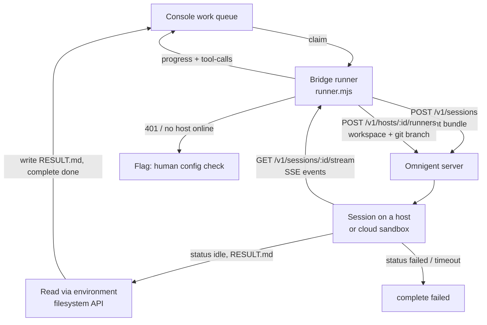

# Omnigent as a delivery runner — architecture

**Ticket:** DAT-221 · **Status:** design, **verified against the real Omnigent API**
· **Scaffolding:** landed; vendor calls still stubbed (see [§7](#7-scaffolding-delivered-by-this-ticket)).

This document specifies how Omnigent is added as a runner option alongside Claude
Code and Codex, so a lead can drop a ticket into **◆ Deploy to Agent** and have it
executed by Omnigent with no change to the board, the queue, or the ticket
lifecycle.

> **Read this first.** The first revision of this document was written without
> access to Omnigent's API and marked every vendor-side claim **⚠ CONFIRM**. Those
> claims have now been checked against the actual project and **the central premise
> was wrong**: Omnigent is not a hosted SaaS with a vendor API key. It is an
> open-source, self-hosted meta-harness. Sections 2, 4, 5.3, 6 and 8 changed
> materially as a result. Every vendor statement below is now sourced — see
> [§10](#10-verified-against).

---

## 0. What Omnigent actually is

[`omnigent-ai/omnigent`](https://github.com/omnigent-ai/omnigent) — Apache-2.0,
Python 3.12+, installed with `uv tool install omnigent` or `pip install omnigent`.
The CLI is on PATH twice, as `omnigent` and `omni`. The project describes itself as
a **meta-harness**:

> a common orchestration layer over Claude Code, Codex, Cursor, OpenCode, Hermes,
> Pi, and the agents you write yourself.

Three consequences reshape this design:

1. **It is not a vendor SaaS.** There is no `api.omnigent.ai`, no vendor API key and
   no per-seat tenant. You run the server; `omnigent server` serves a web UI and a
   REST + SSE API on `http://localhost:6767` by default, and it deploys to your own
   infrastructure — **including Databricks Apps**, which is what this console
   already is.
2. **It orchestrates the harnesses we already run.** An Omnigent-backed runner would
   execute a ticket via Claude Code or Codex *underneath* Omnigent. The value on
   offer is orchestration — sub-agents, cross-vendor review, policies, spend caps —
   not a new model.
3. **An agent is a YAML file**, not an API object: a prompt, an
   `executor.harness`, and `tools` (local Python functions, MCP servers, or
   sub-agents). That file is the unit of handoff.

```yaml
name: delivery_runner
prompt: <the console's server-rendered prompt>
executor:
  harness: claude-sdk        # claude-native, codex, cursor, hermes, opencode, pi, ...
tools:
  delivery_console:
    type: mcp
    url: https://<console>/api/mcp
```

**Status: alpha**, by the project's own badge. That belongs in the risk column for
anything pointed at a live delivery queue.

---

## 1. The existing runner contract

Two seams already exist, and they are not the same thing. Getting them
straight is the whole design.

### 1.1 The console contract (HTTP) — stable, Omnigent-agnostic

The console owns a work queue and knows nothing about how work gets done. A runner
is *any process that can reach the app URL with a Databricks OAuth token*
([devbox-integration.md](./devbox-integration.md)). The lifecycle is:

```
queued → claimed → working → done | failed        (or cancelled by a lead)
```

| Step | Endpoint |
|---|---|
| Wait for work | `GET /api/agent/work/wait` (long poll) |
| Claim atomically | `POST /api/agent/work/claim` → work package + server-rendered prompt |
| Vend git credential | `POST /api/agent/work/:id/git-credential` (~1h GitHub App token) |
| Progress note / heartbeat | `POST /api/agent/work/:id/progress` |
| Live tool feed | `POST /api/agent/work/:id/tool-calls` (batched, ≤200/batch) |
| Raise / clear a flag | `POST` / `DELETE /api/agent/work/:id/flag` |
| Finish | `POST /api/agent/work/:id/complete` (`done` \| `failed`) |

**Nothing in this layer changes for Omnigent.** That is the point of the design: an
Omnigent-backed runner is a client of exactly these endpoints, so the board, the
STALLED detector, PR auto-linking, comment steering and telemetry archival all keep
working untouched.

### 1.2 The harness contract (in-process) — subprocess-shaped

`devbox-runner/harnesses.mjs` is where the fleet's agent-specific code lives. An
adapter is:

```js
{ name, bin, args, promptVia, parseLine(line, emit), writeConfig(dir, mcpServerPath) }
```

`runner.mjs` owns the invariant lifecycle — wait → claim → materialize workdir →
heartbeat → run agent → read `RESULT.md` → complete — and touches none of the above.

**This seam assumes the agent is a local child process**, and it assumes it in four
separate places:

1. `runAgent()` calls `spawn(HARNESS.bin, args)` — there must be an executable.
2. Output arrives as **lines on stdout**, which is why the hook is `parseLine`.
3. Completion is a **process exit code**.
4. The result is `RESULT.md` **on the local filesystem**, written by the agent into
   the workdir the runner created.

Omnigent has an executable, so (1) is satisfied — but its `run` command is an
interactive REPL/TUI with no stdout event stream, and its structured output,
status and produced files all live behind the server API. So (2), (3) and (4)
still do not hold in the form the seam expects. **The widened seam earns its
keep; the reason changed.**

---

## 2. Two shapes — and Omnigent is both

The first revision guessed at "local CLI *or* hosted service". Omnigent is both, and
the choice between them is now an evidence-based one rather than a coin flip.

| | **Shape A — local CLI** | **Shape B — server API** |
|---|---|---|
| Entry point | `omnigent run <agent.yaml> -p "<prompt>"` | `POST /v1/sessions` + `POST /v1/hosts/{id}/runners` |
| Live feed quality | **raw, unparsed** — no stdout JSON stream | **structured** — typed SSE events |
| Result retrieval | files in the local workdir | environment filesystem API |
| Console work | none (`HARNESS=generic` works today) | the `mode: 'service'` seam (landed) |
| Adapter mode | `process` | `service` |

### 2.1 Shape A works today, with a degraded feed

`omnigent run` accepts a prompt non-interactively:

```bash
HARNESS=generic AGENT_BIN=omnigent AGENT_LABEL=omnigent \
  AGENT_ARGS='run --harness claude-sdk -p' AGENT_PROMPT_VIA=arg \
  node devbox-runner/runner.mjs
```

This needs **no console change at all**. The cost is the TOOL ACTIVITY feed: the CLI
has no `--output-format stream-json` equivalent. `--log` writes conversation JSON and
`--debug-events` writes an SSE tape, but both go to files under `~/.omnigent/logs/`,
not stdout, so `parseLine` has nothing structured to read. The drawer would show raw
terminal output.

### 2.2 Shape B is the recommended v1

**Recommendation: build Shape B.** Not because Shape A fails, but because everything
the console actually needs from a runner — a structured event stream, a status
vocabulary, produced-file retrieval, cancellation, spend caps — is defined and typed
on the server API and absent from the CLI's stdout. The merged `mode: 'service'` seam
is therefore the right seam; it just needs real endpoints instead of invented ones.

Note that Shape A is not a shortcut around Shape B: `omnigent run` **spawns a local
server and connects to it as an HTTP client**. The server API is the substrate
either way.

---

## 3. Target architecture

The runner box becomes a **bridge**: it still owns the console-side lifecycle, but
delegates execution to an Omnigent server and translates between the two.



### 3.1 The adapter contract, mapped to real calls

The existing adapter shape is kept verbatim for `claude`/`codex`/`generic`. One
discriminator field is added, defaulting to today's behaviour so nothing existing
moves:

```js
mode: 'process' | 'service'    // absent ⇒ 'process'
```

Each service method now maps to a **concrete, verified** operation:

| Method | Omnigent operation |
|---|---|
| `submit({ pkg, prompt, workdir, git }, ctx)` | `POST /v1/sessions` (multipart agent-bundle create) → session id, then `POST /v1/hosts/{host_id}/runners` with `{ session_id, workspace, git: { base_branch, branch_name } }` |
| `poll(handle, ctx)` | `GET /v1/sessions/{id}` for `status`, plus `GET /v1/sessions/{id}/stream` (SSE) for events — or `GET /v1/sessions/{id}/items` as a pollable fallback |
| `fetchResult(handle, ctx)` | `GET /v1/sessions/{id}/resources/environments/{env}/filesystem/RESULT.md`; `OutputFileDone` events name produced files |
| `cancel(handle, ctx)` | `DELETE /v1/sessions/{id}` (the SDK also models a `ClientTaskCancel` event) |

Supporting operations the bridge needs:

- `GET /v1/hosts` / `GET /v1/hosts/{id}` — is a host online to run on?
- `GET /v1/runners/{runner_id}/status` — runner-level status.
- `POST /v1/sessions/{id}/agent/mcp-servers` — register the delivery-console MCP
  server so the agent posts its own progress notes and flags.
- `POST /v1/sessions/{id}/resources/environments/{env}/shell` — run a shell command
  in the session environment (`git push`, validation commands).
- `GET /v1/usage`, `POST /v1/policies` — spend visibility and caps (§5.4).

`runner.mjs` gains exactly one branch — `mode === 'service'` drives a poll loop
instead of `spawn` — and every other stage of the lifecycle is shared code.

### 3.2 Why events, not lines

`parseLine` exists to turn a stdout line into `emit.print(text)` / `emit.tool(name, input)`.
A service adapter emits into **the same `emit` sink** from `poll()`. That is what
keeps the live TOOL ACTIVITY feed, the terminal rendering and the telemetry archive
identical across harnesses — the bridge changes where events come from, not what
they are.

Omnigent's stream is a typed SSE envelope, and it maps onto the sink cleanly:

| Omnigent event | Sink call |
|---|---|
| `TextDelta`, `MessageDone` | `emit.print(text)` |
| `ToolCall`, `NativeToolCall` | `emit.tool(name, input)` |
| `ToolResult` | `emit.print` on failure only, to match the Codex adapter's noise level |
| `ReasoningStarted` / `ReasoningDelta` / `ReasoningSummaryDelta` | dropped, or gated behind a verbose flag |
| `ResponseCompleted` / `ResponseFailed` / `ResponseCancelled` / `ResponseIncomplete` | terminal state transitions |
| `RetryEvent`, `ErrorEvent` | `emit.print` — visible, since these explain stalls |
| `OutputFileDone` | names a produced file to fetch (`RESULT.md`) |
| `ElicitationRequest` | **the agent is asking a human a question** — see §5.2 |
| `CompactionInProgress` / `Completed` / `Failed` | optional; useful for long-run diagnosis |

Because SSE is a live stream rather than a cumulative log, the cursor concern from
the first revision largely dissolves: the bridge consumes forward. It still needs a
resume position if the stream drops mid-run — `GET /v1/sessions/{id}/items` replays
session history for that case.

---

## 4. Task handoff format

### 4.1 Board → Omnigent (submit)

The console already renders the authoritative prompt server-side and ships it in the
work package (`pkg.prompt`) — *prompt wording is owned by the console repo, so
changing it is a console deploy, not a fleet update*
([development-standards.md](./development-standards.md)). The bridge must not
rewrite it.

The unit of handoff is an **agent bundle**: an agent YAML (plus any tool files),
uploaded as multipart to `POST /v1/sessions`. `pkg.prompt` becomes the agent's
`prompt` verbatim:

```yaml
name: dat_221_task_157
prompt: |
  <pkg.prompt verbatim — the server-rendered instructions>
executor:
  harness: claude-sdk
tools:
  delivery_console:
    type: mcp
    url: https://<console-host>/api/mcp
```

The workspace and git branch are **not** part of the bundle — they are arguments to
Launch Runner, which is what makes this fit the delivery contract so neatly:

```jsonc
// POST /v1/hosts/{host_id}/runners
{
  "session_id": "<from the create call>",
  "workspace":  "<path or repo workspace on the host>",
  "git": {
    "base_branch": "main",
    "branch_name": "DAT-221-omnigent-runner",   // the console's branch convention
    "existing_worktree": null
  }
}
```

Notes that matter:

- **The prompt is the contract.** It already tells the agent to branch as
  `DAT-221-<slug>`, push, open a PR, check the PR for merge conflicts, and write
  `RESULT.md`. Omnigent inherits all of that.
- **`git.branch_name` is native.** The first revision's biggest open question was
  whether Omnigent could do git at all. It takes a base branch and a branch name as
  first-class launch parameters, tracks `git_branch` on the session, and exposes
  `GET /v1/hosts/{id}/worktrees`. Git is a hard install prerequisite.
- **Attachments** should go through `POST /v1/sessions/{id}/resources/files` (there
  is a real file-upload API) rather than base64 in a JSON body, as the first
  revision speculated.
- **Run limits** are enforced by the bridge's `MAX_RUN_MINUTES` watchdog and, better,
  by an Omnigent **cost policy** (§5.4) — a spend cap is a more meaningful bound on
  an agent run than wall-clock alone.

### 4.2 Omnigent → board (poll and result)

The normalized shapes the adapter must produce are unchanged — they are our
contract, not the vendor's:

```jsonc
// poll(handle) →
{
  "state": "running",                          // running|succeeded|failed|cancelled
  "events": [
    { "kind": "text", "text": "Reading the runner contract…" },
    { "kind": "tool", "name": "Read", "input": { "file_path": "devbox-runner/harnesses.mjs" } }
  ]
}

// fetchResult(handle) →
{
  "summary": "2–4 sentences on what was done…\nhttps://github.com/org/repo/pull/42",
  "prUrl": "https://github.com/org/repo/pull/42"      // optional; parsed from summary if absent
}
```

**`RESULT.md` is written by the bridge, not by Omnigent.** The agent writes
`RESULT.md` inside its own session environment; the bridge reads it back over the
environment filesystem API and writes it into the runner workdir before the existing
completion logic reads it. This deliberately preserves the delivery contract already
enforced in `runner.mjs`:

> a clean exit does NOT count as done unless the agent wrote `RESULT.md`

so an Omnigent run that reaches a terminal state with no `RESULT.md` still completes
**failed** and lands back in the backlog, rather than parking an empty "done" in
Review. That rule was earned; the bridge must not launder around it.

---

## 5. Status polling, error and retry behaviour

### 5.1 Polling and streaming

- **Prefer the SSE stream** (`GET /v1/sessions/{id}/stream`) for events; it is
  outbound-only, so it fits the runner's "no ingress" posture, and it removes the
  polling-interval tradeoff for the live feed entirely.
- **Still poll `GET /v1/sessions/{id}`** on a slow timer (15 s) for authoritative
  `status`, `total_cost_usd` and `last_task_error`. A dropped SSE connection must
  not look like a finished run.
- **Console heartbeat stays on its own 120 s timer**, independent of Omnigent. A
  stalled *session* must never look like a stalled *runner*, and vice versa — they
  are different incidents with different owners.
- **Tool-call batching is unchanged:** events flow into the existing
  `ToolCallStream`, which flushes every 4 s or 25 events.

### 5.2 The status vocabulary is known — and `idle` is the trap

The session `status` field is a closed enum:

```
idle | running | waiting | failed
```

This maps onto our four states, but **not one-to-one**, and the mismatch is the
single most important implementation detail in this document:

| Omnigent | Ours | Why |
|---|---|---|
| `running` | `running` | direct |
| `failed` | `failed` | direct; surface `last_task_error` verbatim |
| `waiting` | `running`, then **flag** | the agent is blocked on input (`ElicitationRequest`). An autonomous runner has nobody to answer it, so a `waiting` session that persists is a stall: raise the flag, let the watchdog end it. |
| `idle` | **ambiguous** | `idle` is *both* "not started yet" and "finished the turn". It is **not** a success signal. |

Resolve `idle` by the response lifecycle, never by status alone: a run is
`succeeded` only when a terminal `ResponseCompleted` has been seen **and**
`RESULT.md` is retrievable. `ResponseFailed` → `failed`; `ResponseCancelled` →
`cancelled`; `ResponseIncomplete` → `failed` (it means the model stopped early —
truncation or a hit limit — which is not a delivery).

Treating bare `idle` as success is exactly the failure the merged
`normalizeState()` comment warned about: it would complete real tickets as empty
successes.

### 5.3 Failure taxonomy

Classification matters more than the retry counts — it decides who gets paged.

| Class | Example | Bridge behaviour |
|---|---|---|
| **Transient vendor** | 429, 502/503/504, connection reset on `poll`; SSE drop | Retry with exponential backoff + jitter, cap 5 attempts; resume events via `GET …/items`. Do **not** fail the task; a poll failure is not a run failure. |
| **Submit failure** | non-2xx from session create, no session id | Retry twice, then `complete failed` with the error in `summary`. Nothing has run, so nothing is stranded. |
| **Auth / config** | 401/403, no host online, harness not installed | **No retry.** Raise `POST …/flag` (yellow on the board, no lane change) and `complete failed`. A credential or capacity problem is a human config check, not a machine retry. |
| **Run failure** | session `status: failed` | `complete failed` with `last_task_error` surfaced verbatim in `summary`. |
| **Blocked on input** | `status: waiting` / `ElicitationRequest` | Flag immediately; the run cannot proceed unattended. Cancel at the watchdog deadline. |
| **Timeout / budget** | exceeds `MAX_RUN_MINUTES`, or a cost policy denies | `cancel(handle)` then `complete failed`, reusing the existing watchdog wording. |
| **Console cancellation** | heartbeat returns 404/409 | `cancel(handle)`, abandon, return to waiting — no completion call. Mirrors `killAgent()` for process harnesses. |
| **Lost handle** | bridge crashes mid-run | The session survives on the server and is resumable (`host_resumable`, `omnigent run --resume`), so this is **recoverable** — persist the session id on the task record. See [Gaps](#8-gaps-and-blockers). |

### 5.4 Spend caps are a first-class feature — use them

Omnigent ships cost policies as builtins, settable server-wide, per-agent or
per-session (`POST /v1/policies`, `POST /v1/sessions/{id}/policies`):

```yaml
policies:
  budget:
    type: function
    handler: omnigent.policies.builtins.cost.cost_budget
    factory_params:
      max_cost_usd: 5.00
      ask_thresholds_usd: [3.00]
```

The bridge should attach a per-session cost policy at submit time, sized from the
ticket estimate, and read `total_cost_usd` back onto the task record. This closes the
first revision's "no per-ticket spend cap" gap with a vendor feature rather than a
console feature.

### 5.5 What is deliberately *not* retried

Re-submitting a task that may already be running is worse than failing it: two
Omnigent runs on one ticket means two branches, two PRs, and a merge-conflict
escalation against yourself. **Session create is only retried when we are certain no
session id was issued.** Note that session creation and *execution* are separate
calls here (`POST /v1/sessions`, then Launch Runner), which narrows the ambiguous
window considerably: a create that may or may not have landed can be reconciled
against `GET /v1/sessions` before anything executes.

---

## 6. Credentials and configuration

### 6.1 The decision — corrected

The first revision decided to store "Omnigent's API key" in the `delivery-console`
Databricks secret scope and vend it per task over a new
`POST /api/agent/work/:id/omnigent-credential` endpoint.

**That endpoint should not be built. There is no Omnigent API key.** Omnigent is
self-hosted and has two distinct credential concerns:

| Concern | What it is | Where it lives |
|---|---|---|
| **Server auth** | Who may call the Omnigent server's `/v1` API | An Omnigent account token (`omnigent login <host>`), OIDC, or — when the server is a Databricks App — **Databricks OAuth** |
| **Model credentials** | The Anthropic/OpenAI/Databricks credential the harness uses | Per **host**, stored on the Omnigent side: `POST /v1/hosts/{id}/harnesses/{harness}/credential` |

**Recommendation: deploy the Omnigent server as a Databricks App in the same
workspace as this console, and authenticate to it with a Databricks service
principal.** This is a supported, documented posture — the CLI takes
`--server https://<app>.databricksapps.com --profile <sp>`, described in its own help
as the headless service-principal path — and it means:

- **No new secret and no new vending endpoint.** Runners already hold a Databricks
  OAuth token to reach the console; the same identity model covers Omnigent.
- **Model spend is governed by the workspace**, via the `databricks` extra, rather
  than by a vendor key nobody owns.
- **The rule still holds** — *no long-lived tokens at rest*
  ([development-standards.md](./development-standards.md)) — without inventing a
  second credential path to maintain.

If Omnigent is instead run outside Databricks, fall back to the original pattern: an
account token in the `delivery-console` secret scope, vended per task. The decision
is then unchanged in shape; only the secret's name differs.

### 6.2 Git credentials — the constraint that survived

Nothing here changes the git-token problem, and it remains the sharpest operational
edge:

> Vended GitHub App tokens live ~1h; runs are allowed 3h (`MAX_RUN_MINUTES=180`). A
> hosted agent holding a token for hours finds it dead exactly when it pushes — after
> all the work is done.

**Recommend capping Omnigent runs under 60 minutes for v1.** A shorter cap is a known
limitation; a dead token is a mystery failure. *(This document's own run hit exactly
this: the git remote's embedded token had expired by the time the task was picked
up.)*

### 6.3 Configuration surface

| Var | Default | Purpose |
|---|---|---|
| `OMNIGENT_BASE_URL` | `http://localhost:6767` | Omnigent server root (local default; set to the deployed app URL) |
| `OMNIGENT_TOKEN` | — | Server account token; unset when using Databricks OAuth |
| `DATABRICKS_CONFIG_PROFILE` | — | Service-principal profile when the server is a Databricks App |
| `OMNIGENT_HOST_ID` | — | Host to launch runners on; resolved from `GET /v1/hosts` if unset |
| `OMNIGENT_HARNESS` | `claude-sdk` | Which harness Omnigent should drive |
| `OMNIGENT_WORKSPACE` | — | Workspace path passed to Launch Runner |
| `OMNIGENT_POLL_MS` | `15000` | Status poll interval (events come over SSE) |
| `OMNIGENT_MAX_COST_USD` | — | Per-session cost policy cap (§5.4) |

### 6.4 What Omnigent must *never* receive

- The Databricks OAuth token **as a bearer credential for calling us back** — it is
  the console's front-door credential. (Using Databricks identity to authenticate
  *us to Omnigent* is the opposite direction and is fine.)
- Anything beyond a **single-repo, short-TTL** git credential.
- Secrets echoed into progress notes or PR bodies — the existing standard applies
  unchanged.

Also note: **Omnigent's telemetry is on by default** and opt-out
(`docs/telemetry`). For client work that is a procurement question, not a
footnote — settle it before a live engagement runs through it.

---

## 7. Scaffolding delivered by this ticket

The seam is real and tested; the four vendor calls still throw a pointer to this
document rather than guessing. What changed in this revision is that they are now
**implementable without further design work** — the endpoints, the status vocabulary
and the event shapes below are verified, not assumed.

| File | Change |
|---|---|
| `devbox-runner/harnesses.mjs` | `omnigentHarness()` — a `mode: 'service'` adapter skeleton with `submit`/`poll`/`fetchResult`/`cancel`, env-driven config now carrying **real** `/v1` paths, and `NOT_IMPLEMENTED` throws citing this doc. Registered in `getHarness()`. |
| `devbox-runner/runner.mjs` | `runAgent()` dispatches on `HARNESS.mode`; `runService()` implements the poll loop, event fan-out into the existing `emit` sink, and bridge-written `RESULT.md`. Process harnesses take the identical path they always did. |
| `server/routes/agents.ts` | `inferHarness()` maps `*omnigent*` → `omnigent`; `HARNESS_PROVIDER.omnigent = 'omnigent'`. |
| `client/src/components/AgentLogos.tsx` | Omnigent mark, `HARNESSES` + `PROVIDERS` entries, `HARNESS_DEFAULT_PROVIDER` mirror. |
| `client/src/components/RunnerLogo.tsx` | `inferHarness()` mirror, so runner avatars brand correctly. |
| `tests/harness-abstraction.test.ts` | Service-adapter shape assertions, the server↔client table pins, and `normalizeState()` coverage for Omnigent's real `idle\|running\|waiting\|failed` vocabulary. |

A runner named `omnigent-1` therefore already registers, brands and groups correctly
on the `/agent-map` Agent Map and on ticket cards — the console half is genuinely done.

### 7.1 Implementation checklist

1. Stand up an Omnigent server (Databricks App recommended, §6.1) and register a
   host with a coding harness installed.
2. Fill `submit` — bundle the agent YAML from `pkg.prompt`, `POST /v1/sessions`,
   then Launch Runner with `git.branch_name`.
3. Fill `poll` — consume SSE, map events per §3.2, and resolve terminal state per
   §5.2 (**never** treat bare `idle` as success).
4. Fill `fetchResult` — read `RESULT.md` over the environment filesystem API.
5. Fill `cancel` — `DELETE /v1/sessions/{id}`.
6. Attach a cost policy at submit time (§5.4) and cap runs under 60 min (§6.2).
7. Register the delivery-console MCP server on the session so the agent posts its own
   progress and flags.
8. Run one ticket end to end on a scratch repo before pointing it at
   `engagement-console`.

---

## 8. Gaps and blockers

The first revision was blocked on vendor documentation. **That blocker is cleared** —
the API is public and was read directly. What remains is smaller and mostly
operational.

Resolved since the first revision:

| First revision's question | Answer |
|---|---|
| Can Omnigent clone/commit/push from its sandbox? | **Yes.** Git is a hard prerequisite; Launch Runner takes `base_branch`/`branch_name`; sessions track `git_branch` and hosts expose worktrees. |
| Is there a submit idempotency key? | **Partly moot.** Create and execute are separate calls, and `GET /v1/sessions` reconciles an ambiguous create before anything runs. |
| Are status events cursorable? | **Better — they stream.** SSE for live events, `GET …/items` to replay. |
| Streaming vs polling? | **SSE**, outbound-only, compatible with the no-ingress posture. |
| Orphaned runs if the bridge dies? | **Recoverable.** Sessions are server-side and resumable; persist the session id. |
| Does Omnigent support MCP? | **Yes, first-class** — agent YAML `type: mcp` and a per-session MCP-server API. |
| Cost and concurrency controls? | **Built in** — cost-budget policies, `GET /v1/usage`, `total_cost_usd` per session. |

Still open, ranked by how much damage a bad answer does:

1. **Alpha software in the delivery path.** The project self-describes as alpha and
   was pushed to on the day of writing. Pin a version, and do not let an alpha
   orchestrator sit between a lead and a client deliverable without a rollback.
2. **The runner fleet is Windows; Omnigent is degraded there.** On Windows the
   native tmux/PTY harness wrappers are unavailable, and there is **no filesystem or
   network sandboxing** — only Job Object process containment. Agents run
   unsandboxed. Either run the Omnigent host on Linux/macOS (or a cloud sandbox), or
   accept that posture explicitly.
3. **`POST /v1/sessions` is under-specified in the published OpenAPI** (empty request
   schema — it is a multipart bundle route). The exact bundle layout should be
   confirmed against `omnigent-client` or a live server before implementing `submit`.
4. **Which harness runs underneath?** If Omnigent drives `claude-sdk`, the console is
   paying an orchestration layer to run the agent it already runs directly. The case
   for Omnigent is sub-agents, cross-vendor review and policies — worth stating as a
   goal, because it decides whether the agent YAML is one agent or a Polly-style
   supervisor.
5. **Telemetry is on by default** (§6.4) — a procurement question for client work.
6. **Where does the host run?** A persistent host is capacity to manage; a cloud
   sandbox per session (Modal/E2B/Daytona/Databricks) is cleaner but adds a second
   vendor. Not a blocker for v1, but it decides the ops story.

---

## 9. Acceptance criteria mapping

| Criterion | Where |
|---|---|
| Architecture write-up: handoff, polling, result retrieval, error/retry | §4, §5 |
| Runner interface defined, each method mapped to a concrete Omnigent API call | §3.1 — now **real endpoints**, verified against the published OpenAPI |
| Credential/config storage approach decided and documented | §6 |
| Gaps/blockers in Omnigent's API explicitly called out | §8 |
| Minimal scaffolding matching the existing runner pattern | §7 |

---

## 10. Verified against

Read directly from the upstream project on 2026-08-13 (repo last pushed the same
day). Anything not listed here should be treated as inference, not fact.

| Source | Used for |
|---|---|
| [`omnigent-ai/omnigent`](https://github.com/omnigent-ai/omnigent) `README.md` | What Omnigent is, install, CLI names, agent YAML, harness list, policies, sandbox and Databricks support, Windows limitations, telemetry |
| `openapi.json` (OpenAPI 3.2.0, "Omnigent Server" v0.1.0, 99 operations) | Every `/v1` endpoint, the session `status` enum, `total_cost_usd`, `last_task_error`, `git_branch`, `LaunchRunnerRequest` |
| `sdks/python-client/` (`README.md`, `_client.py`, `_events.py`) | HTTP + SSE transport, multipart session create, the event class vocabulary |
| `omnigent/cli.py` | `omnigent run` options — `-p/--prompt`, `--harness`, `--server`, `--profile`, `--log`, `--debug-events`; local server + REPL architecture |

**Not verified:** the multipart bundle layout for `POST /v1/sessions` (§8.3), and
behaviour of any of this against a live server — no Omnigent instance was available
to call. Nothing below §3 has been executed end to end.
