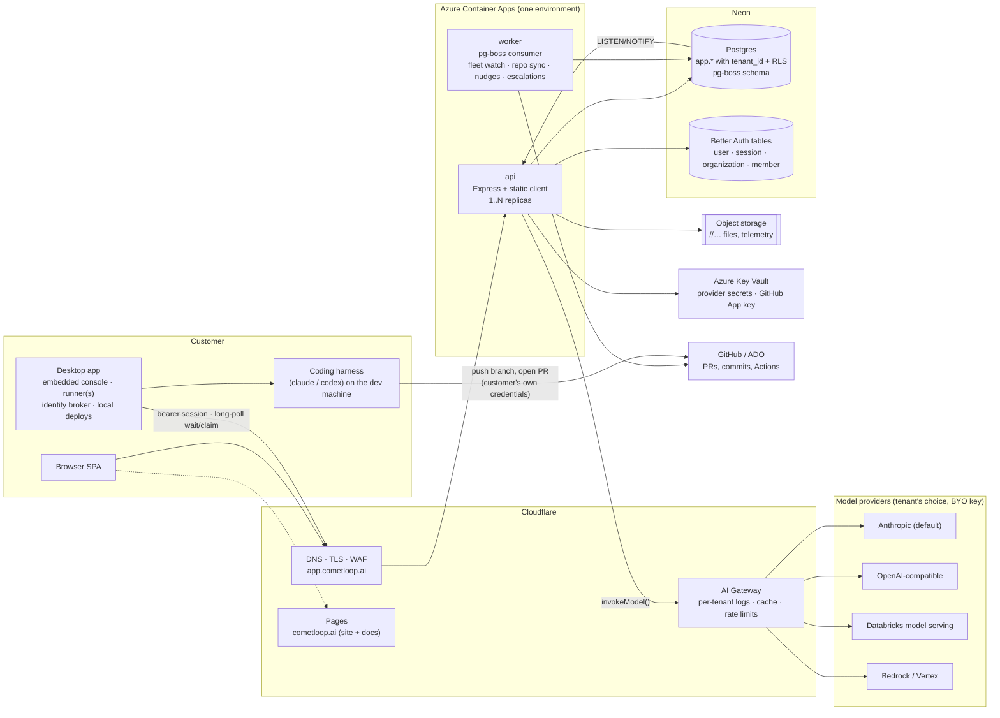

# Cometloop platform architecture — off Databricks, multi-tenant

The migration plan for turning the Execution Console (one Databricks App, one
customer) into **Cometloop**, a multi-tenant control plane that any customer
can sign up to. Written for whoever executes it — most likely a coding agent
working ticket by ticket. Every claim about the current system cites the file
that proves it; every target decision below is already made (see "Goal") and
is not up for debate in the tickets, only the how.

Companions: [architecture.md](./architecture.md) (what runs today),
[development-standards.md](./development-standards.md) (working agreements),
[llm-fallbacks.md](./llm-fallbacks.md) (the model-call contract that must
survive the provider change).

## 1. Goal and non-goals

**Goal.** One deployment serves many customers (tenants). A customer signs
up, gets an organization, invites their team, connects their repos, points
the console at their own model provider, and installs the desktop app on
their developers' machines. Datavail is tenant #1.

Decided target stack (chosen; do not re-litigate):

| Concern | Decision |
|---|---|
| Postgres | **Neon**. Neon has been owned by Databricks since 2025 and Lakebase is built on it, so this is not vendor independence — it is chosen on merit: plain Postgres, branching for previews, Neon Auth. The exit is `pg_dump` to any Postgres. |
| Auth | **Better Auth, managed by Neon Auth**. Users, sessions, organizations live as tables in the same Postgres. Organization plugin = tenants; SSO plugin (OIDC/SAML) later. Leaving Neon Auth = self-hosting Better Auth on the same tables. |
| Models | Provider registry behind `invokeModel()`, per-tenant model config, **Cloudflare AI Gateway** in front. BYO keys/providers per tenant; Anthropic default; Databricks model serving becomes one provider option. |
| Compute | **Azure Container Apps**: the stateless Express+React control plane as a Docker image, plus a worker for background jobs. |
| Static site | **Cloudflare Pages** at cometloop.ai (done, separate repo). |
| Agents | Keep running on customers' machines via the desktop app. The control plane never holds git credentials for customer code. Hosted runners are a later premium tier. |
| Tenancy | Shared database, `tenant_id` on every row, Postgres row-level security. `tenant_id` = Better Auth organization id. Keep the door open to DB-per-tenant. |

**Non-goals.**

- Databricks stays a *deployment option* (a customer may run Cometloop as a
  Databricks App against Lakebase with Databricks model serving), not the
  foundation. Nothing in `server/` may import `@databricks/appkit` after
  phase 5 except inside the `databricks` adapters.
- No hosted runners in this plan. The queue contract
  (`docs/devbox-integration.md`) does not change.
- No rewrite of the client. The React SPA and the desktop webview embedding
  stay as they are; identity and base URL are the only things they notice.

## 2. Current dependencies on Databricks

| Dependency | How deep | Where in the code | Replacement |
|---|---|---|---|
| AppKit bootstrap (`createApp`, plugin lifecycle) | Shallow: one file | `server/server.ts` — `createApp({ plugins: [files, lakebase, server, serving] })` then `setupApiRoutes({ lakebase, server, files, serving })` | Plain Express `app.listen()`; `setupApiRoutes` already takes an `AppKitServices` interface (`server/routes/api.ts:70`) — supply our own implementation of the four members. |
| Lakebase Postgres via `lakebase()` plugin | Shallow in code, deep in ops. Every module takes `Query = (text, params) => Promise<{ rows }>` and `api.ts:765` binds `q = appkit.lakebase.query`. The pool's password is a workspace OAuth token refreshed hourly (AppKit lakebase plugin docs). | `server/routes/api.ts` (`initSchema`, `q`), every `*_SCHEMA_SQL` array, `scripts/dev-migrate.cjs` | `pg.Pool` from `DATABASE_URL` (Neon). Same `Query` type, so route modules do not change. The dev-owned vs SP-owned table split (`development-standards.md` "Ownership rule", `deploy.yml` "Run database migrations") disappears: one owner role on Neon. |
| Identity from the Apps OAuth proxy | Medium. Headers `x-forwarded-preferred-username` / `x-forwarded-email`; `x-forwarded-access-token` used to call SCIM `/Me` for group → role mapping. | `server/routes/roles.ts` `resolveIdentity()` (groups `eec-admins`, `eec-engagement-leads` → `admin`/`lead`/`developer`; **no token → admin**); inline `requestAuthor()` copies in `api.ts:751`, `mcp.ts:49`, `ticket-consolidate.ts:175`, `ticket-decision.ts:53`, `ticket-links.ts:74`; `requireLead`/`requireAdmin`/`requireAnyLead` closures in `setupApiRoutes`; `project-access.ts` `projectAccessGuard(q, resolveIdentity)` | One identity module with a pluggable verifier (section 5). Better Auth session cookie or bearer token → `{ userId, email, tenantId, orgRole }`. |
| Model serving via `serving('default')` | Shallow: one choke point plus two side doors | `server/routes/llm-health.ts` `invokeModel()` (hardcodes `serving('default').invoke(body)`; `invokeError()` reads AppKit's `{ ok:false, status, message }` wrapper); side doors: `agents.ts` `invokeAgentEndpoint()` (raw fetch to `/serving-endpoints/<name>/invocations` with an M2M token from `workspaceToken()` using `DATABRICKS_CLIENT_ID/SECRET`), `agents.ts` `fetchEndpointState()`, `agent-models.ts` `getWorkspaceClient()` endpoint listing | Provider registry (section 6). `invokeModel` keeps its signature minus the `serving` argument; the two side doors become methods on the `databricks` adapter. |
| UC volumes via `files()` plugin | Shallow: a 4-method interface (`upload`, `download`, `list`, `delete`, `api.ts:77`) | `appkit.files('files')` for SOW uploads, context files, ticket attachments, file library, standards docs (`api.ts:1748`, `context-files.ts`, `ticket-attachments.ts`, `file-library.ts`, `standards.ts`); `files('telemetry')` for tool-call NDJSON (`tool-calls.ts`, `api.ts:2157`) | Object storage behind the same 4-method interface, keyed `<tenant_id>/<engagement>/...`. Open question 1 picks the bucket (Azure Blob or Cloudflare R2). |
| Workspace OAuth for runners and desktop | Medium, all in clients | `desktop/src/main/oauth.ts` (PKCE against the workspace using public client `databricks-cli`, loopback `:8020`), `credentials.ts` (refresh token in `safeStorage`), `index.ts:444` (injects `Authorization: Bearer` into the webview session), `devbox-runner/runner.mjs` `token()` (`databricks auth token`), `mcp/server.mjs`, `scripts/*.mjs` | Better Auth sessions (browser) and bearer tokens / API keys (desktop, runner, MCP). `shared/api-client/index.ts` `ConsoleClient` already abstracts this behind `getToken()`. |
| Deploy: bundle + Apps | Medium, all in CI | `.github/workflows/deploy.yml` (typecheck → lint → build → `databricks bundle deploy` → `dev-migrate.cjs` → `bundle run app`), `databricks.yml` (schema, two volumes, app, postgres, serving endpoint, secret scope), `app.yaml` (env from resources) | Docker image → ACR → `az containerapp update` (section 7). Keep the bundle files for the Databricks deployment option. |
| Secrets | Shallow | `app.yaml` `GITHUB_APP_PRIVATE_KEY` from secret scope `delivery-console` | Azure Key Vault references on the container app. |
| Client UI kit | Trivial | `client/src/index.css` imports `@databricks/appkit-ui/styles.css`; `client/src/ErrorBoundary.tsx` imports `Card*` | Inline the few CSS variables and a local `Card`; drop the package. |
| Beta dashboard reads | External | `token-usage.ts` header mentions a "Lakehouse-Federation path" reading `app.run_token_usage` | Not carried; usage is exposed via the API instead. |

Not a dependency: the queue, coordination, event trail and every board flow
are plain SQL over `app.*` and move untouched.

## 3. Target architecture



Runners keep the outbound-only contract (`docs/devbox-integration.md`): they
long-poll `/api/agent/work/wait`, claim, run the harness locally, and push
with credentials the desktop's identity broker holds on the developer's
machine (`desktop/src/main/identity.ts`). The control plane vends nothing
for customer repos; the GitHub App path (`server/routes/github-app.ts`) stays
for tenants who install Cometloop's GitHub App, as an option, not a
requirement.

## 4. Tenancy

**Status: shipped in phase 2** (`server/db/`, PR "Phase 2: multi-tenancy").
This section describes what is in the code; the phase-3 list at the end is
what was deliberately left for later.

### Tables

Every tenant-scoped table in the `app` schema carries
`tenant_id TEXT NOT NULL`. The list is `TENANT_TABLES` in
`server/db/tenancy.ts` — 45 tables, one per `CREATE TABLE IF NOT EXISTS` in
the module `*_SCHEMA_SQL` arrays — and `tenancy.test.ts` fails the build if a
new array creates a table that is in neither `TENANT_TABLES` nor
`GLOBAL_TABLES`. The global allowlist is exactly the tenant directory:

| Table | Purpose |
|---|---|
| `app.tenants (id TEXT PK, name, created_at)` | one row per tenant; `t_cometloop` is the existing customer and every pre-tenancy row belongs to it |
| `app.tenant_members (tenant_id, email, role)` | email → tenant for Better Auth sign-ins whose token carries no organization claim; unique on `(tenant_id, LOWER(email))`; the lead's email is seeded into `t_cometloop` as `owner` |

Rule (unchanged): `tenant_id` goes on **every** row even where
`engagement_id` would imply it, so a policy never needs a join. "Shared" in
the registry means shared within a tenant, never across.

`tenant_id` defaults to
`COALESCE(NULLIF(current_setting('app.tenant_id', true), ''), 't_cometloop')`.
Route modules never name the column in an INSERT: the default lands the row
in the request's tenant, and — the single-tenant compatibility path — in
`t_cometloop` when no tenant is set on the connection. Dropping that
fallback is the first phase-3 cleanup.

### Keys: unique per tenant

Ticket keys and engagement ids stay human (`CL-12`, `cometloop`) and are
unique **per tenant**: two tenants may both own `CL-1`. What changed, all
generated from lists in `server/db/tenancy.ts`:

- `PRIMARY_KEYS` — 13 primary keys now lead with `tenant_id`:
  `tickets (tenant_id, key)`, `engagements (tenant_id, id)`, `suggestions`,
  `engagement_members`, `engagement_leads`, `branch_activity`,
  `runner_polls`, `planning_reviews`, `project_runner_configs`,
  `project_standards`, `nudge_settings`, `runner_load_balancing`,
  `ticket_activity`. `SERIAL` ids and the random-UUID `id TEXT` keys
  (`file_*`, `ticket_attachments`) are untouched — a globally unique
  surrogate is fine, RLS hides the rows.
- `UNIQUE_CONSTRAINTS` — the inline `UNIQUE (…)` on `repo_connections`,
  `ticket_links` and `file_folders` gained `tenant_id`.
- `UNIQUE_INDEXES` — `team_members_email_unique`, `agent_tasks_active_ticket`,
  `project_agents_eng_name`, the two registry `*_scope_slug` indexes and
  `ticket_nudges_quiet_period` moved out of the module arrays into
  `tenancy.ts` (so boot does not recreate the global form every start) and
  gained `tenant_id`.
- `FOREIGN_KEYS` — all 34 `REFERENCES app.tickets(key)` /
  `REFERENCES app.engagements(id)` are now composite
  `(tenant_id, ticket_key) REFERENCES app.tickets (tenant_id, key)`, same
  `ON DELETE` action as before. `tenancy.test.ts` asserts the list equals
  what the module arrays declare.

The 14 `ON CONFLICT (…)` clauses whose target was one of those keys name
`tenant_id` first now (`ON CONFLICT (tenant_id, engagement_id)` etc.) —
Postgres infers the arbiter index from the exact column set, so this was the
one change the route modules could not avoid. Ticket-key allocation needed no
change: the next number is derived from the keys already on the engagement,
which under RLS are the tenant's, so the sequence is per
`(tenant_id, engagement_id)`; `tickets.seq` (SERIAL) is only the board's
ordering surrogate. The engagement-id uniqueness probe on create is likewise
RLS-scoped.

### The migration

`TENANCY_SCHEMA_SQL` is the last boot array `initSchema` runs (after every
module array, so the tables exist). Forward-only, idempotent, generated —
`bootSchemaSql()` in `api.ts` is the ordered whole. Per table:
`ADD COLUMN IF NOT EXISTS tenant_id … DEFAULT 't_cometloop'` (constant
default = metadata-only backfill), then `SET DEFAULT` to the
`current_setting` form. Postgres has no `ADD CONSTRAINT IF NOT EXISTS`, so
every key rewrite is a `DO $$ … $$` block that reads `pg_constraint` for the
**live** constraint (by definition text, not by the name the arrays assume),
drops the old primary key `CASCADE` (which takes the old single-column FKs
with it) and adds the composite one; FKs and policies are guarded the same
way. A second boot changes nothing — the integration test snapshots
`pg_constraint`, `pg_policies`, `pg_indexes` and the `tenant_id` columns,
boots again, and asserts equality.

### Row-level security

```sql
ALTER TABLE app.tickets ENABLE ROW LEVEL SECURITY;
ALTER TABLE app.tickets FORCE ROW LEVEL SECURITY;
CREATE POLICY tenant_isolation ON app.tickets
  USING (tenant_id = current_setting('app.tenant_id', true))
  WITH CHECK (tenant_id = current_setting('app.tenant_id', true));
```

…for all 45 tables, none on the directory. **Read this before touching the
role logic:** on Neon the role in `DATABASE_URL` (`neondb_owner`) owns every
table *and* carries `BYPASSRLS`. `FORCE` makes an owner subject to its
policies, but a `BYPASSRLS` role skips them regardless — on Neon, FORCE alone
would enforce nothing. So the migration also creates a `cometloop_app` role
(`NOLOGIN NOBYPASSRLS`, plain DML + sequence grants, default privileges for
future tables) and grants it to the connecting role, and the scoped query
layer runs every tenant query as that role. The boot migration itself keeps
running as the owner: that is what lets it ALTER tables and backfill with no
tenant set, and the same owner connection (`adminQuery`) serves the tenant
directory reads and the one-off scripts. `FORCE` is still set so an owner
without `BYPASSRLS` (docker-compose's Postgres, any non-Neon host) is
covered too.

### Setting the tenant per query

`server/db/tenant-context.ts` holds the tenant in an `AsyncLocalStorage`;
`runWithTenant(tenantId, fn)` is the only way in. `requireSignIn` runs the
rest of the middleware chain inside it, so every route module keeps calling
its `q` with no signature change — the portable runtime's `q`
(`server/db/scoped-query.ts`) reads the context and runs each statement as

```
BEGIN; SET LOCAL ROLE cometloop_app; SELECT set_config('app.tenant_id', <tenant>, true);
<statement>;
COMMIT;
```

`SET LOCAL` and a transaction-scoped `set_config` are undone by COMMIT or
ROLLBACK, so a pooled connection cannot leak one request's tenant or the
app role into the next. It is one transaction **per statement**, not per
request, on purpose: handlers catch and continue past individual query
errors (an aborted request-long transaction would reject everything after
the first), and the runner long-poll holds a request open for ~55 s (a
request-long transaction would pin a pool client and its row locks). Cost is
two extra round trips per statement. With no tenant in the context the
statement still runs as `cometloop_app` with the setting unset and the
policies match nothing — reads return no rows, writes are rejected — and the
statement shape is logged once, so a code path that reaches the database
outside `runWithTenant` is a visible bug, never a leak.

The AppKit (Databricks) runtime has no per-query client (`lakebase.query`
is a bare pool), so `tenantIsolation` is false there: the columns and
composite keys still land, RLS and the app role are not created, and it logs
that isolation is single-tenant compatibility only.

**Background loops** are per tenant: `startPerTenant(adminQuery, start)`
(`server/db/tenant-loops.ts`) reads `app.tenants` and calls `start` once per
tenant inside `runWithTenant`, so the `setInterval`s the pollers create
inherit the tenant and every tick is scoped — repo sync, review-SLA
escalation, stale nudges, fleet watch, the planning-review sweep and the
demo mock runner each run once per tenant. The directory is re-read every
minute so a tenant created after boot gets its loops without a restart.

**Runner routes** (`/api/agent/*`, sign-in exempt) take the tenant from the
identity when one is present (the Databricks proxy → `t_cometloop`). With no
identity — runners on the portable runtime today, whose Databricks bearer
token means nothing without the proxy — they are scoped to
`ANONYMOUS_RUNNER_TENANT_ID` (`t_cometloop`) rather than to nothing, so the
one existing fleet keeps working. Phase 3 replaces this with per-tenant
runner API keys.

### Tenant from identity

`Identity.tenantId` (section 5): `t_cometloop` for the `databricks` and
`dev` verifiers; for `better-auth`, the first of the
`activeOrganizationId` / `organizationId` / `org` claims that looks like a
tenant id, else `app.tenant_members` by email (`setTenantDirectory`, wired
by `setupApiRoutes` on the owner connection). An identity with no tenant is
answered 403 `{ error: 'No workspace' }` by the sign-in gate.

### What the integration test proves

`server/tenancy.integration.test.ts` runs only with `TEST_DATABASE_URL`, on a
throwaway Neon branch of production (`neon branches create --name phase2-test
--parent production`, deleted afterwards). On that copy it boots the full
schema, snapshots the catalog, boots again and asserts nothing changed;
checks every pre-tenancy ticket is `t_cometloop`'s; creates two tenants,
inserts `CL-1` (plus engagement and comment) in each through the scoped
query exactly as the routes do; asserts each tenant sees only its own
`CL-1` and none of production's rows; asserts an INSERT and an UPDATE under
A that name B's `tenant_id` are rejected by the policy, a delete of A's row
under B touches nothing, an unscoped query sees nothing and an unscoped
write is rejected, and that after a scoped statement the pooled connection
is back to the owner with no tenant set.

### Phase-3 cleanup list

1. **Drop the `'t_cometloop'` fallback** from every `tenant_id` default
   (`ALTER COLUMN tenant_id SET DEFAULT NULLIF(current_setting('app.tenant_id', true), '')`)
   once every writer is known to run inside `runWithTenant` — the boot seed
   and `scripts/*.mjs` are the ones to wrap first.
2. **Better Auth organization wiring**: the organization plugin's id becomes
   `tenant_id` (replace the claim list in `identity.ts` with the one claim
   Neon Auth actually emits), organization membership replaces
   `app.tenant_members`, and sign-up creates the `app.tenants` row.
3. **Per-tenant runner API keys** replace `ANONYMOUS_RUNNER_TENANT_ID`; an
   anonymous runner then sees no queue.
4. `tenant_id REFERENCES app.tenants(id)` on every table (skipped now to keep
   the first migration to keys and policies), and a tenant-delete path.
5. AppKit runtime: either a per-query client so `tenantIsolation` can be
   true there too, or retire the runtime (section 7).
6. Revisit the per-statement transaction cost with the phase-4 worker split
   (a request-scoped client with SAVEPOINTs is the obvious next step).

DB-per-tenant later: because every query already runs inside
`runWithTenant`, a tenant → `DATABASE_URL` map in the scoped query layer is
the only change needed to give a customer their own Neon project.

## 5. Identity

### What the server verifies

Today `resolveIdentity()` (`server/routes/roles.ts`) trusts proxy headers and
maps workspace groups to `admin | lead | developer`. Target: one module
`server/identity/index.ts` exporting the same `resolveIdentity(req)` shape,
extended:

```ts
export interface Identity { userId: string; email: string; tenantId: string; role: 'admin' | 'lead' | 'developer'; }
export interface IdentityVerifier { verify(req: express.Request): Promise<Identity | null>; }
```

with two verifiers behind a config switch (`IDENTITY_MODE=better-auth |
databricks-headers`):

- **better-auth** — `auth.api.getSession({ headers })` from the Better Auth
  server instance (Neon Auth manages the tables; the server still needs the
  Better Auth SDK to validate). Accepts the session cookie (browser) and, via
  the `bearer` plugin, `Authorization: Bearer <session token>` (desktop,
  runner, MCP). `tenantId` = `session.activeOrganizationId`; role from the
  organization `member.role`.
- **databricks-headers** — the current code, kept verbatim for the
  Databricks deployment option. `tenantId` is the single configured tenant.

Collapse the five inline `requestAuthor()` copies into
`identity.email` from the same resolver; `requireLead`, `requireAdmin`,
`requireAnyLead` and `projectAccessGuard` keep their signatures. The
"no token → admin" local-dev shortcut (`roles.ts:29`) must not survive into
the Better Auth verifier; local dev signs in like production against the
docker-compose Postgres.

### Roles

| Console role today | Source today | Better Auth organization role |
|---|---|---|
| `admin` | group `eec-admins` | `owner` / `admin` |
| `lead` | group `eec-engagement-leads` + row in `app.engagement_leads` | `member` with a row in `engagement_leads` (unchanged table, now tenant-scoped) |
| `developer` | everyone else | `member` |

`app.engagement_leads` and `app.engagement_members` stay the per-engagement
authority; the organization role only decides admin. Invitations use the
organization plugin's invite flow; `app.team_members.email` links a member
to the roster on first sign-in.

### Desktop app

- `desktop/src/main/oauth.ts` swaps the workspace PKCE flow for a
  Cometloop sign-in: open `https://app.cometloop.ai/desktop/sign-in` in the
  system browser, receive the session token on the existing loopback
  `:8020` redirect (or the Better Auth device-authorization plugin; either is
  a contained change in `oauth.ts` + `credentials.ts`). The token is stored
  with `safeStorage` exactly as the refresh token is now.
- `index.ts:444` (webview header injection) and `ConsoleClient.getToken()`
  do not change. `forceRefresh` on a 401 becomes "prompt to sign in again"
  since Better Auth sessions renew server-side while in use.
- `PUT /api/agent/self` (`shared/api-client/index.ts` `reportAgent`) is
  tenant-scoped through the session; nothing in the payload changes. The
  identity broker (GitHub / Azure / ADO device-code sign-ins) is untouched —
  that is the whole point of agents staying on customer machines.
- Headless runners (`devbox-runner/runner.mjs`, `mcp/server.mjs`) replace
  `databricks auth token` with a tenant API key (Better Auth `apiKey`
  plugin) passed as the bearer; `token()` becomes a one-liner.

## 6. Model providers

**Status: shipped in phase 3** (`server/llm/`, PR "Phase 3: model
providers"). This section describes what is in the code. The user-facing
contract is the site's *Model providers* and *Security* pages; the names
here are theirs.

### The layer

```
caller (api.ts, scoping-agent.ts, estimates.ts, standards.ts, pr-review.ts)
  │  invokeModel(role, ChatRequest, { flow, engagementId, ticketKey, modelOverride? })
  ▼
server/routes/llm-health.ts        reliability: retry-once, categorize, per-flow counters, ⚠ feed item
  │  resolveRole(q, role) → { adapter, config, model, capabilities }   (server/llm/config.ts)
  │  checkContract(role, needs, capabilities)                            refuse a model that cannot serve the role
  │  resolveModel(config, model, metadata) → ResolvedModel               credential by NAME (server/llm/credentials.ts)
  ▼
server/llm/providers/<kind>.ts     one wire format each, over fetch; returns ChatResponse
  │
  └─ recordControlPlaneUsage(...)  → app.run_token_usage (source = 'control-plane')
```

`ChatRequest` is provider-neutral — `system`, `messages` (user / assistant
/ tool turns, assistant turns carrying `toolCalls`), `maxTokens`, `json`,
`tools`, `temperature` — and `ChatResponse` is `{ text, toolCalls, usage:
{ input, output, cacheRead, cacheCreate }, model, provider }`. Callers no
longer guess at response shapes: the `unwrap` / `extractText` helpers that
used to live in four route modules are gone, and the scoping agent's tool
loop reads `response.toolCalls` directly.

### Registry (`server/llm/provider.ts`, `server/llm/providers/`)

```ts
export interface ModelProvider {
  readonly kind: 'anthropic' | 'openai-compatible' | 'databricks' | 'bedrock' | 'vertex';
  readonly capabilities: { json: boolean; tools: boolean; contextTokens: number };
  capabilitiesFor(model: ResolvedModel): ProviderCapabilities;   // per model family, extra.contextTokens override
  chat(request: ChatRequest, model: ResolvedModel, signal?: AbortSignal): Promise<ChatResponse>;
}
```

| Adapter | Wire format | Notes |
|---|---|---|
| `anthropic` | Messages API, `x-api-key` | `json` → a system-level "reply with a single JSON object" instruction (no prefill, so the callers' first-brace regex keeps working); tools ↔ `tool_use` / `tool_result` blocks, consecutive tool results folded into one user turn. Context: 1M for the 5-family, 200k otherwise. |
| `openai-compatible` | Chat Completions, bearer key | Covers OpenAI, Neon AI Gateway, Groq, Together, vLLM, Ollama; `json` → `response_format: json_object` with one retry without it when the server rejects it. Azure OpenAI when `extra.apiVersion` is set: `base_url` is the resource, the model is the deployment, `api-key` header. |
| `databricks` | `/serving-endpoints/<name>/invocations`, SP M2M token | The model id IS the endpoint name. A 400/422 retries the responses-style `input` body (Agent Bricks). This adapter also owns `workspaceToken()`, `fetchEndpointState()` (Agents page) and `listServingEndpoints()` (the model picker), so there is one Databricks code path. |
| `bedrock`, `vertex` | — | Declared with their row shape (`extra.region` / `extra.project`), throw `ProviderNotAvailableError` ("not configured in this build"); `invokeModel` treats that like an unmapped role — no retry, no feed item, the fallback applies. |

Adapters throw `ProviderError { status }`; `categorizeFailure` and
`isTransientStatus` in llm-health.ts key on that status exactly as they
did on the serving wrapper's.

### Per-workspace configuration (`server/llm/config.ts`)

```sql
CREATE TABLE app.model_providers (
  id SERIAL PRIMARY KEY, name TEXT, kind TEXT, base_url TEXT,
  credential_ref TEXT,        -- the NAME of an env var / Key Vault secret, never the value
  default_model TEXT, extra JSONB, created_at, updated_at
);                            -- + tenant_id and RLS from the phase-2 migration
CREATE TABLE app.model_roles (role TEXT, provider_id INT REFERENCES app.model_providers(id) ON DELETE CASCADE, model TEXT, updated_at);
                              -- primary key (tenant_id, role)
```

Roles are the capability contract (`ROLE_CONTRACTS`), with the site's names:

| Role | Flows | Needs |
|---|---|---|
| `planning` | `ticket-refine`, `comment-rework`, `sow-parse`, `standards-refine` | JSON, tool use (the board-aware scoping loop), ≥100k context |
| `estimate` | `estimate` | JSON, ≥16k |
| `review` | `pr-review` | JSON, ≥100k |
| `draft` | `status-draft` | prose, ≥16k |

`checkContract` runs twice: at save time (`PUT /api/settings/model-roles`,
against the role's declared needs → 422 naming the gap) and at call time
(against what the request actually carries — `json`, `tools` — plus the
role's context floor → the call is refused, counted as a `payload`
failure, and the fallback applies). Tools are only demanded of a model when
the request carries tools, so a single-shot planning call still works on a
model without tool use.

**Defaults.** Nothing is seeded. `ensureTenantLlmDefaults` runs once per
tenant (at boot in the per-tenant loop start, and lazily on the first
resolve): a workspace with no provider rows gets an `anthropic` provider
with `credential_ref = 'ANTHROPIC_API_KEY'` when that variable is present,
every role mapped (`planning`/`review` → `claude-sonnet-5`,
`estimate`/`draft` → `claude-haiku-4-5-20251001`); failing that, the
workspace serving endpoint when `DATABRICKS_SERVING_ENDPOINT_NAME` and the
SP pair are present (the pre-phase-3 deployment shape, so a Databricks
deploy keeps working with no configuration). Deleting the last provider
marks the tenant checked so the row does not come back until a restart.

**Settings API** (`server/routes/model-settings.ts`, admin-only):
`GET/POST /api/settings/providers`, `PUT/DELETE /api/settings/providers/:id`,
`POST /api/settings/providers/:id/test` and `POST /api/settings/providers/test`
(an unsaved draft — the wizard's Test step), `GET/PUT /api/settings/model-roles`.
The API returns `credentialRef` and where it resolves (`env` /
`key-vault` / `missing`), never a value; `extra` is allow-listed per key.
The UI is the *Model providers* section of the web Admin page
(`client/src/components/ModelProviders.tsx`): provider cards with a status
dot, an Add-provider wizard (logo grid → details → test → save), and the
role → model table. Provider logos are `MODEL_PROVIDER_PRESETS` in
`shared/design/AgentLogos.tsx`.

### Secrets (`server/llm/credentials.ts`)

`resolveCredential(ref)` reads `process.env[ref]` first (local, docker,
dedicated installs that inject secrets as env); otherwise, with
`AZURE_KEY_VAULT_URL` set, `getSecret(name)` through
`DefaultAzureCredential` (`@azure/keyvault-secrets` + `@azure/identity`,
imported lazily), with `_` mapped to `-` for Key Vault's name rules and a
five-minute cache. A vault error resolves to null, which the adapter turns
into a 401 → `auth` in the health counters, never a crash. Rotation is a
new secret version plus the cache window.

### Cloudflare AI Gateway (`server/llm/gateway.ts`)

`AI_GATEWAY_URL` (`https://gateway.ai.cloudflare.com/v1/<account>/<gateway>`)
turns routing on for the whole process. A vendor URL whose host has a native
gateway route (`api.anthropic.com` → `/anthropic`, `api.openai.com` →
`/openai`, Groq, Mistral, DeepSeek, Perplexity, OpenRouter; Azure OpenAI →
`/azure-openai/<resource>/<deployment>`) is rewritten onto the gateway; the
tenant's own key stays in the upstream auth header. Every gateway call
carries `cf-aig-metadata: {"tenant","role","flow","ticket","project"}`, and
`extra.gateway.cacheTtl` / `skipCache` become `cf-aig-cache-ttl` /
`cf-aig-skip-cache`. A self-hosted OpenAI-compatible endpoint has no native
route and stays direct; any row can opt out with `extra.bypassGateway`
(the "per-workspace switch" on the site). Databricks workspace hosts are
always direct.

### Fallbacks, health and usage

The table in [llm-fallbacks.md](./llm-fallbacks.md) is unchanged: the
adapter throws, `invokeModel` retries and surfaces, the caller's `catch`
degrades. `GET /api/llm/health` now reports **per role** — mapping,
contract gap, and a cached live probe for each configured role — and is 200
only when every configured role answers.

Usage: `app.run_token_usage` gained `source` (`'harness' | 'control-plane'`),
`provider` and `role`. `invokeModel` inserts one control-plane row per
successful call (`task_id 0`, `agent 'control-plane'`, never `final`) from
`ChatResponse.usage`, attributed to the ticket and project the caller
passed. `usageByTicket` folds both sources (`bySource`, `controlPlaneCalls`,
per-model rows carry `provider`) and the ticket drawer shows the split;
`usageByAgent` keeps to harness rows so the agent map never shows the
control plane as a runner.

### The PR reviewer as a skill

`server/routes/pr-review-skill.ts` seeds a shared `app.registry_skills` row
per workspace (`slug pr-review`, `role review`, `output_schema` = the
verdict JSON schema, `harnesses []`) with the reviewer prompt as a template
(`{{ticket_key}}`, `{{diff}}`, … — the prose is editable, the data blocks
are the console's). `runPrReview` resolves the `review` role, renders the
project's or workspace's template, and calls
`invokeModel('review', …, { modelOverride })`, where the override is a
project's registered endpoint-backed `pr-reviewer` agent when — and only
when — the review role's provider is Databricks. That keeps every
pre-phase-3 deployment reviewing exactly as it did while a workspace on
Anthropic or OpenAI reviews on its own model with no agent registered.
`agents.ts` no longer has an invoke path of its own.

### Not implemented from the site docs

- **Key Vault writes.** The site says "keys are stored in Key Vault the
  moment you save them". The console never handles a key value: an admin
  puts the secret in Key Vault (or the environment) and enters its *name*.
  The write path (a form field that goes straight to Key Vault and stores
  only the name) is a Cloud-only concern for the phase that gives the api a
  Key Vault write identity.
- **Bedrock and Vertex** adapters are stubs (above).
- **Platform default** (Cometloop's own Anthropic account, metered) is
  today the process's `ANTHROPIC_API_KEY` auto-registered per workspace —
  metering per workspace is the usage ledger; a separate platform key per
  workspace is not modelled.
- **Per-workspace gateway cache TTL / rate limit** are stored on the
  provider row (`extra.gateway`) and sent as headers; rate limits are a
  gateway-side setting, not sent per request.

## 7. Compute

### Images

One `Dockerfile` at the repo root, multi-stage on `node:22-alpine`: install →
`npm run build` (client Vite bundle + server) → runtime stage with `dist/`
and production deps. Two entrypoints from the same image:

- `node dist/server/main.js` — api. Replaces `createApp`: builds the pg pool,
  the identity verifier, the provider registry, the storage client, then
  calls `setupApiRoutes()` with an object satisfying `AppKitServices` and
  serves `client/dist` statically.
- `node dist/server/worker.js` — worker.

`docker-compose.yml` for local dev: `postgres:17`, the api, and the worker,
with `EEC_SEED_DEMO=1` seeding the demo portfolio (`api.ts:258`).

### Worker and queue

Every background loop is an in-process `setInterval` started from
`setupApiRoutes` (`api.ts:2265-2282`): `startRepoPolling(q, 90_000, 30_000)`,
`startEscalationPolling(q, 5 min)`, `startStaleNudgePolling(q, 30 min)`,
`startFleetWatch(q, 60_000)`, the planning-review sweep
(`planning-review.ts:116`) and the demo `startMockRunner`. With N api
replicas these would run N times. Move them behind **pg-boss** (queue and
schedules in Postgres, schema `pgboss`, no new infrastructure):

- The worker registers each `tick` as a pg-boss scheduled job with the same
  interval and `singletonKey` so it runs once fleet-wide, wrapped in
  `withTenant` per tenant.
- One-shot work that today runs inline on a request — `estimateTicket` after
  ticket create/refine, `runPrReview` on PR open, telemetry archiving — is
  published as a job so the request returns fast and a model timeout cannot
  hold an HTTP worker.
- `WORKER_INLINE=1` runs the same consumers inside the api process for the
  single-process Databricks option and for docker-compose.

### Real-time

`/api/notifications/stream` (`notifications.ts:173`) is SSE with an
in-process `listeners` map keyed by email, so a notification created on
replica A never reaches a browser connected to replica B. First step: the
writer does `NOTIFY cometloop_notify, '<email>'` and every replica
`LISTEN`s on a dedicated client and fans out to its own listeners. The board
poll (8 s, `architecture.md`) stays as is; converting it to SSE is a later
ticket on the same channel.

### Azure Container Apps

- One environment, two container apps: `api` (external ingress, 1–N
  replicas, HTTP concurrency scale rule) and `worker` (no ingress, 1
  replica; pg-boss tolerates more).
- Secrets are Key Vault references (`DATABASE_URL`, `BETTER_AUTH_SECRET`,
  `GITHUB_APP_PRIVATE_KEY`, Gateway token); the app's managed identity has
  `get` on the vault.
- Custom domain `app.cometloop.ai`: Cloudflare DNS CNAME (proxied) to the
  api's ingress FQDN, ACA managed certificate, Cloudflare in Full (strict).
- Revisions: single-revision mode with the health probe on `GET /api/llm/health`
  replaced by a cheap `GET /healthz` (DB ping) so a bad model key cannot
  block a rollout.

### GitHub Actions

`deploy.yml` becomes two workflows:

- `deploy-cometloop.yml` (on push to `main`): desktop typecheck → typecheck
  → lint → build → `docker build` → push to ACR → run migrations as a one-off
  `az containerapp job` against Neon `main` → `az containerapp update
  --image` for api then worker. Same concurrency group as today.
- `deploy-databricks.yml` (`workflow_dispatch`): today's bundle deploy,
  kept for the Databricks option.

Preview environments: on `pull_request`, create a Neon branch from `main`
(`neonctl branches create`), deploy the PR image to a `preview-<pr>`
container app with that branch's `DATABASE_URL`, comment the URL on the PR,
delete both on close. Migrations run against the branch, which is how a
destructive migration gets rehearsed on real data without touching
production.

### Schema migrations

The boot `*_SCHEMA_SQL` arrays stay the source of truth for fresh installs
and are still executed by `initSchema()` at boot (idempotent). What changes:
`scripts/dev-migrate.cjs` — the workaround for the Lakebase ownership split
— is retired once on Neon, and any statement that must run before the new
code (composite-key rewrites, RLS) lives in a numbered file under
`server/db/migrations/` run by the CI migration job. The standards doc's
"Database and migrations" section is rewritten in phase 5.

## 8. Migration plan

Phases 0–4 ship into the current Databricks deployment behind config
switches and do not break it; 5 and 6 are the move. Each phase is one or a
few tickets with the definition of done below.

**Phase 0 — Portability proof (docker-compose).**
`Dockerfile`, `docker-compose.yml`, `server/main.ts` that satisfies
`AppKitServices` with `pg.Pool` from `DATABASE_URL`, a local-disk
implementation of the 4-method files interface, and the existing `serving`
wired to a stub. *Done when:* `docker compose up` boots, `initSchema` creates
every table on vanilla Postgres, the demo seed loads, the board renders,
and CI runs the vitest suite against that Postgres instead of pg-mem for the
schema tests. Databricks deployment untouched (`server.ts` still the Apps
entrypoint).

**Phase 1 — Identity seam.**
`server/identity/` with `IdentityVerifier`, the `databricks-headers`
verifier extracted from `roles.ts`, the five `requestAuthor` copies removed,
`tenantId` added to `Identity` (constant `T1` in header mode). Better Auth
verifier implemented and exercised only in docker-compose. *Done when:*
production still authenticates through the proxy with no behaviour change;
docker-compose signs in through Better Auth; the "no token → admin" path is
gone.

**Phase 2 — `tenant_id` + RLS. Shipped** (section 4 is the as-built
description). `TENANT_TABLES` and the coverage test, `tenant_id` on all 43
tables (default kept as the `t_cometloop` fallback — dropping it is phase
3's first item), composite keys for every human key and every FK onto them,
`runWithTenant` + AsyncLocalStorage, the gate running handlers inside the
tenant, per-tenant loop sets, RLS enabled + forced with a `cometloop_app`
role because Neon's owner carries `BYPASSRLS`. On the AppKit runtime the
columns and keys land but isolation stays off (bare pool, no per-query
client). Proven on a Neon branch of production by
`server/tenancy.integration.test.ts` rather than in docker-compose.

**Phase 3 — Provider registry + AI Gateway.** *Shipped* (section 6).
`server/llm/` with the interface, the `databricks` adapter (auto-registered
for a Databricks deploy, unchanged behaviour), the `anthropic` and
`openai-compatible` adapters, `bedrock` / `vertex` stubs,
`app.model_providers` + `app.model_roles`, `invokeModel(role, …)` resolving
per tenant with the capability contract, credentials by name (env → Key
Vault), Cloudflare AI Gateway routing, `run_token_usage` `source` /
`provider` / `role` columns with control-plane rows, the PR reviewer as a
`pr-review` registry skill, the Admin page's Model providers section and
`/api/llm/health` per role. Left for later: Key Vault *writes* from the
settings form, the Bedrock and Vertex adapters.

**Phase 4 — Worker + queue.**
pg-boss, `worker.ts`, the five loops as scheduled jobs, `estimateTicket`
and `runPrReview` as published jobs, LISTEN/NOTIFY fan-out for the
notification stream, `WORKER_INLINE=1` for the Apps deployment. *Done when:*
production runs with `WORKER_INLINE=1` and no `setInterval` remains in
`api.ts`; docker-compose runs api ×2 + worker ×1 and a notification created
through either api replica reaches a browser on the other.

**Phase 5 — ACA deploy + Neon.**
Neon project with `main` and preview branches; Better Auth via Neon Auth;
Key Vault; ACR; the two container apps; `deploy-cometloop.yml`; preview
workflow; object storage behind the files interface; `pg_dump` of Lakebase
restored into Neon `main` (tenant #1 already tagged); RLS forced. *Done when:*
`app.cometloop.ai` serves the restored data, a PR gets a preview URL on a
Neon branch, migrations run from CI, and the desktop app signs in with the
new flow against it.

**Phase 6 — Cutover + Databricks-as-option.**
Runners and the desktop fleet repointed (`APP_URL`, sign-in), read-only
window on the Databricks app, final `pg_dump`/restore delta, DNS flip,
Databricks app stopped. `deploy-databricks.yml` kept on `workflow_dispatch`
with `IDENTITY_MODE=databricks-headers`, `WORKER_INLINE=1` and the
`databricks` provider as the documented single-tenant option. Docs updated:
`architecture.md`, `development-standards.md` (migrations, LLM calls,
secrets), `desktop/README.md`, `devbox-runner/README.md`, `beta-runbook.md`.
*Done when:* no `@databricks/*` import outside `server/llm/providers/databricks.ts`
and `server/identity/databricks-headers.ts`, and a second tenant has
completed sign-up → engagement → queued ticket → PR on their own repo with
their own model key.

## 9. Open questions

1. **Object storage**: Azure Blob (same cloud as ACA, managed identity) or
   Cloudflare R2 (S3 API, no egress, same account as DNS/Gateway)? Decides
   the files-interface implementation in phase 5 only.
2. **Ticket key display vs identity**: decided and shipped in phase 2 —
   composite `(tenant_id, key)`, human keys unique per tenant.
3. **GitHub App per tenant**: today one App id lives in `app.yaml`. Customers
   install Cometloop's App on their org (simplest, App key stays ours), or
   bring their own App/PAT via `repo_connections.auth_type`. ADO is still
   DAT-147.
4. **Transactional email** for Better Auth (verification, invitations,
   magic links) and the notification digest (`renderEmailDigest`) — provider
   not chosen.
5. **Metering and billing**: `run_token_usage` gives cost per tenant; whether
   the platform key is resold with a margin or tenants must BYO from day one
   changes the default in `tenant_model_config`.
6. **Session model for runners**: API keys (headless, revocable) versus the
   desktop's user session for runner traffic — affects how a runner's
   actions are attributed in `feed_items` and `agent_tasks.agent`.
7. **Data residency**: Neon region and ACA region per tenant is the
   DB-per-tenant door; not needed for launch, but the region should be a
   tenant attribute from phase 2 so it is not a migration later.

## 10. Dedicated deployments (a customer's own Azure subscription)

Some customers will run Cometloop inside their own Azure tenant rather than
on Cometloop Cloud. The design above already makes that a packaging and
release exercise, not a fork: **one codebase, one image, one Terraform
module, one tenant row.** Dedicated installs run the same tenancy code with a
single tenant (`t_<customer>`), RLS on, so every fix ships to both shapes.

### The distribution unit

A release is three versioned things, and nothing else:

| Artefact | Where it is published | How a customer references it |
|---|---|---|
| Container image (`api` and `worker` entrypoints) | `ghcr.io/nsdallenbach/cometloop:<version>` (GitHub Container Registry, pull-token per customer when gated) | `image` variable of the Terraform module |
| Infra module | `infra/azure` at the release tag | `source = "github.com/nsdallenbach/cometloop//infra/azure?ref=v<version>"` |
| Release manifest | `https://cometloop.ai/releases.json` (version, image digest, module ref, notes, minimum schema version) | polled by the update job and shown in the console |

Everything a customer configures — provider keys, SSO, branding, integrations —
lives in their Key Vault and in the `tenants` / settings tables, never in the
image or in per-release Terraform variables. An update is therefore purely a
new image tag, which is what makes it safe to automate.

### What a dedicated install consists of

The same `infra/azure` module applied in the customer's subscription with
`deployment_mode = "dedicated"`: resource group, Log Analytics, Container Apps
environment, `api` + `worker`, Key Vault, managed identity, custom domain.
Differences from Cometloop Cloud, all switched by that one variable:

- **Postgres**: a Neon project in the customer's Neon org, or Azure Database
  for PostgreSQL Flexible Server in their subscription — the app only needs
  `DATABASE_URL` (phase 0). Boot-time migrations run unchanged.
- **Identity**: Neon Auth, or the customer's Entra ID through Better Auth's
  OIDC/SAML plugin; the identity module's verifiers are already pluggable
  (phase 1). Their organisation maps to the single tenant row.
- **Models**: their keys and endpoints (Azure OpenAI is the common case)
  through the per-tenant provider registry; Cloudflare AI Gateway is optional
  and off by default in dedicated mode.
- **Registry pulls**: GHCR credentials in Key Vault, referenced by the
  Container Apps registry block.
- **Licence**: a signed licence file (customer id, seats, expiry) in Key
  Vault, checked at boot — the only genuinely new component.

### How updates reach the customer

Cometloop **publishes; the customer's tenant pulls.** No Cometloop credential
ever has write access to a customer subscription.

1. **Release**: on a `v*` tag the release workflow builds the image once,
   pushes `ghcr.io/…:<version>` (and `:latest`), attaches `infra/` to the
   GitHub Release, and updates `releases.json`. Cometloop Cloud's `deploy.yml`
   is simply the first consumer of that release.
2. **Pull policy, chosen by the customer** — three tiers, all supported:
   - *Managed*: an update job in their tenant (a Container Apps job, or the
     `deploy.yml` template run in a repo they own with OIDC to their
     subscription) polls `releases.json`, runs `az containerapp update` for
     `api` then `worker`, checks `/healthz`, and rolls back to the previous
     revision on failure.
   - *Notified*: the console shows "v1.4.2 available" (from `GET /api/version`
     against `releases.json`); an admin clicks **Update**, which triggers
     their job.
   - *Manual*: they pin a tag and apply on their own schedule. Regulated
     customers will choose this.
3. **Migrations are boot-time and forward-only** (the existing rule, and it
   matters most here): the new image must start against the previous schema
   and migrate it itself; there is no separate migration step a customer can
   skip or run out of order. A `schema_version` row makes the app refuse to
   start against a *newer* schema than it knows, so an image rollback after a
   migration fails loudly instead of corrupting data.
4. **Heartbeat** (opt-in): each install reports version, uptime and migration
   state to a Cometloop endpoint — no customer data — so support knows who is
   on what before anything is deprecated. Release notes flag the minimum
   version an upgrade can start from.

### Code that has to exist for this

- `RELEASE` workflow (tag → image → GHCR → release assets → `releases.json`).
- `deployment_mode`, `registry_credentials` and `licence_secret_name`
  variables in `infra/azure`; dedicated mode skips AI Gateway wiring and the
  multi-tenant loop iteration.
- `GET /api/version`, the `schema_version` guard, the licence check, and the
  heartbeat client.
- A customer-facing runbook (install, update, back up, restore) published on
  cometloop.ai/docs.
